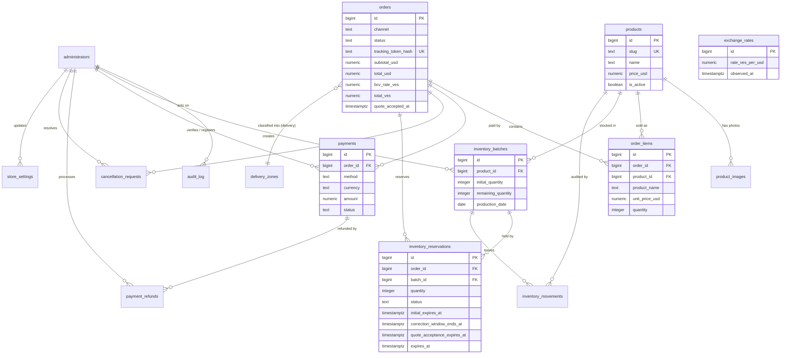

# DATABASE DESIGN

Proposed initial database architecture for Pastelería Online (Phase 1A design).

**Status:** M1 implemented in
`supabase/migrations/001_catalog_and_admin_foundation.sql` (renamed from
`20261114023000_m1_…` when the PR merged) — the tables of §3–§5 and §10.2 plus
the SPEC-confirmed seeds — validated on a local PostgreSQL cluster with a
Supabase stub (roles, `auth`, `storage`) and behavioral RLS tests, then
**applied to the production Supabase project (local ↔ remote synchronized)**.
M2 implemented in `supabase/migrations/002_inventory_foundation.sql` — §6.1
(`inventory_batches`), §6.3 (`inventory_movements`, without `order_id`: deferred
to M3 with `orders`) and the §11 functions `create_inventory_batch`,
`adjust_inventory`, `get_product_stock` — same local validation, **not applied
remotely yet**. M3 implemented in
`supabase/migrations/003_orders_and_reservations.sql` — §6.2
(`inventory_reservations`), the §6.3 `order_id` column/FK/index, §7.1/§7.2
(`orders`, `order_items`), §9.1 (`cancellation_requests`), §10.1
(`exchange_rates`) and the §11 functions `create_online_order`,
`hold_order_reservations`, `open_order_correction_window`,
`release_expired_reservations`, `consume_order_reservations`,
`release_order_reservations`, `get_order_for_tracking`,
`request_order_cancellation`, plus the reservations-aware replacement of
`get_product_stock` (design §11 upgrade path) — same local validation (69
tests), **not applied remotely yet**. Phase 4 / M4 implemented the OQ-17
transition in `supabase/migrations/004_quote_acceptance.sql`: the two new
nullable columns, the four-case `expires_at` invariant (§6.2), the two new
service-role RPCs and the extended PII-free tracking projection (§11) —
validated locally, **not applied remotely**, with migrations 001–004 untouched.
OQ-16 is now implemented additively by migration 005 plus a narrow scheduled
worker (validated locally, 143 tests total, **not applied remotely/deployed**).
The **Payments Module** backend is implemented additively in
`supabase/migrations/006_payments_and_verification.sql`: §8 (`payments`,
`payment_refunds`, `receipt_submissions.payment_id`), the indexes/RLS/grants, the
private `payment-receipts` bucket, audit integration and the §11 service-role
RPCs — behaviorally validated on a disposable local PostgreSQL cluster
(validation details in the final implementation report), **local-only; not
applied remotely, deployed, committed or pushed**. Migrations 001–005 are
untouched. This work is called "Phase 4" in older docs and "Phase 5" in tasking;
both labels refer to the same payments-module scope. Migration
`007_bcv_rates_and_rounding.sql` subsequently adds the exchange-rate write path
(§10.1 — OQ-4) and the rounding rule (OQ-5) as an **additive** change; 006 remains
the applied baseline and 007 rewrites nothing earlier. Migration
`008_realtime_publication.sql` then publishes three existing tables to Supabase
Realtime additively (§11 status below); it changes no policy, grant or table.
The checkout/payment/tracking **UI** and the remaining §11 functions of later
phases stay design only. Every
table below is a
proposal derived from
[`SPEC.md`](../SPEC.md); where the spec leaves a rule undefined, this document
records an open question instead of inventing an answer.

Companion document: [`SECURITY_DESIGN.md`](./SECURITY_DESIGN.md) (roles, RLS
policies, storage access). Decisions and rationale: [`DECISIONS.md`](./DECISIONS.md).

---

## 1. Conventions

Derived from the Supabase/Postgres best-practice guidelines applied throughout:

| Aspect | Convention |
| --- | --- |
| Schema | `public` (exposed via PostgREST). Helper functions live in `private` (not exposed). |
| Identifiers | Lowercase `snake_case`, plural table names (`orders`, `payments`). |
| Primary keys | `bigint generated always as identity` (`uuid` only where the value references an auth user). |
| Timestamps | `timestamptz not null default now()` — every table has `created_at`; mutable tables also have `updated_at` (maintained by trigger). |
| Strings | `text` (no artificial length limits). |
| Money | `numeric` — never float. USD amounts `numeric(10,2)`; VES totals `numeric(14,2)`; exchange rate `numeric(12,4)`; generic payment amounts `numeric(14,2)`. |
| Quantities | `integer` (portions), always `> 0` unless explicitly signed. |
| Statuses / enums | `text` + `CHECK (col IN (...))` — easier to evolve than Postgres enum types. Values are English `snake_case`; the UI translates to Spanish (mapping in §7). |
| Booleans | `boolean not null default …` |
| Constraints | Named (`{table}_{column}_check`, `{table}_{column}_fkey`). |
| Indexes | Every foreign-key column is indexed. Named `{table}_{columns}_idx`. Partial indexes for hot filters (pending work queues). |
| Deleting | Catalog and financial history are never hard-deleted in normal flows: FKs use `restrict` on history tables, `cascade` from an order to its lines/payments. Products are deactivated (`is_active = false`), zones are deactivated, not deleted. |
| Extensions | `pgcrypto` (for `digest()` when hashing tracking tokens). |

Nothing here implements business behavior: values, seeds and state transitions
are proposals to be applied in a later migration phase.

## 2. ER diagram

(Attributes shown are a readable subset; full column lists follow per table.
`exchange_rates` intentionally has no relationship lines: orders copy their
financial snapshot inline instead of referencing rate rows — §10.1.)

## 3. Catalog

### 3.1 `products`

**Purpose:** sellable catalog entries. Starts with three cake-portion varieties
but is fully data-driven — adding a product is an INSERT, never a code change
(SPEC §3). `price_usd` is the authoritative price: it is read by the server at
order creation and never accepted from the client.

| Column | Type | Null | Notes |
| --- | --- | --- | --- |
| `id` | bigint identity | no | PK |
| `slug` | text | no | URL key for `/productos/[slug]`; generated server-side from the name |
| `name` | text | no | |
| `description` | text | no | SPEC §3 requires a description |
| `price_usd` | numeric(10,2) | no | `CHECK (price_usd >= 0)` |
| `is_active` | boolean | no | default `true`; storefront shows only active rows |
| `created_at` | timestamptz | no | SPEC §3 |
| `updated_at` | timestamptz | no | SPEC §3, trigger-maintained |

- **Constraints:** `products_slug_key` UNIQUE (`slug`).
- **Indexes:** `products_slug_idx` (unique, serves lookup by slug),
  `products_active_idx (id) WHERE is_active` (partial index for the storefront
  listing — small and always filtered by `is_active`).
- **Relationships:** referenced by `product_images` (cascade), `order_items`
  (restrict — price history must survive deactivation/removal),
  `inventory_batches` (restrict), `inventory_movements` via batch.
- **Not stored here:** available stock. It is *derived* from batches minus
  active reservations (§6) — a denormalized counter would create the classic
  drift problem without a benefit at this scale.

### 3.2 `product_images`

**Purpose:** photographs per product (SPEC §3), stored as objects in the
**public** `product-images` bucket; rows keep the path and display order.

| Column | Type | Null | Notes |
| --- | --- | --- | --- |
| `id` | bigint identity | no | PK |
| `product_id` | bigint | no | FK `products` on delete cascade |
| `storage_path` | text | no | object path inside the bucket |
| `position` | integer | no | `CHECK (position >= 0)`; `0` is the primary photo |
| `created_at` | timestamptz | no | |

- **Constraints:** `product_images_storage_path_key` UNIQUE (`storage_path`).
- **Indexes:** `product_images_product_id_idx` (FK index; also used by the RLS
  policy that joins to `products.is_active`).
- **Relationships:** many-to-one `products`.

## 4. Configuration

### 4.1 `store_settings`

**Purpose:** singleton row (SPEC §6 pickup address, §13 WhatsApp, §14 hours,
§5 payment instructions). Fields whose structure the spec has not defined yet
are `jsonb` placeholders — deliberately **not** shaped in advance.

| Column | Type | Null | Notes |
| --- | --- | --- | --- |
| `id` | smallint | no | PK with `CHECK (id = 1)` — singleton |
| `pickup_address` | text | yes | configured from the panel (SPEC §6) |
| `whatsapp_phone` | text | yes | displayed/shared for manual WhatsApp contact (SPEC §13) |
| `business_hours` | jsonb | yes | **shape defined in Phase 6** when schedules are implemented (SPEC §14) |
| `payment_instructions` | jsonb | yes | **shape defined in Phase 4** from real Pago Móvil data (SPEC §5, §19 pending) |
| `updated_at` | timestamptz | no | trigger-maintained |
| `updated_by` | uuid | yes | FK `administrators` (set null) |

- **Invariant:** this table contains only customer-facing configuration; no
  secrets (secrets live in environment variables).
- **Relationships:** many-to-one `administrators` (who last edited).

### 4.2 `delivery_zones`

**Purpose:** classification the customer picks at checkout and the fee the
server applies (SPEC §6). Fees and zone *existence* come straight from the
spec; the exact geographic boundaries remain a pending discovery item and are
held as descriptive text, not invented geometry.

| Column | Type | Null | Notes |
| --- | --- | --- | --- |
| `id` | bigint identity | no | PK |
| `name` | text | no | unique |
| `description` | text | yes | human-readable boundary hint; exact limits pending (SPEC §19) |
| `fee_usd` | numeric(10,2) | no | `CHECK (fee_usd >= 0)`; meaningful only when `requires_quote = false` |
| `requires_quote` | boolean | no | default `false`; `true` = manual quote (orders wait for the confirmed fee) |
| `is_active` | boolean | no | default `true` |
| `sort_order` | integer | no | default `0`; checkout display order |
| `created_at` / `updated_at` | timestamptz | no | |

- **Proposed seed rows (from SPEC §6, to be inserted by the migration):**
  1. *Zona norte de Barquisimeto* — `fee_usd = 0`, `requires_quote = false`
  2. *Resto de Barquisimeto* — `fee_usd = 5.00`, `requires_quote = false`
  3. *Fuera de Barquisimeto* — `fee_usd = 0` (unused placeholder), `requires_quote = true`
- **Indexes:** `delivery_zones_name_key` (unique);
  `delivery_zones_active_idx (sort_order, id) WHERE is_active`.
- **Relationships:** referenced by `orders.delivery_zone_id` (restrict —
  deactivate zones instead of deleting them).

## 5. Identity: administrators

### 5.1 `administrators`

**Purpose:** the **single source of truth for authorization**. Supabase Auth
holds credentials (`auth.users`); this table decides who is allowed to do
anything administrative. A user is an admin only if a row exists here with
`is_active = true`. `user_metadata` is never consulted (SPEC §16).

| Column | Type | Null | Notes |
| --- | --- | --- | --- |
| `id` | uuid | no | PK, FK `auth.users(id)` on delete cascade — the auth identity |
| `display_name` | text | no | shown in the panel and written into the audit log |
| `is_active` | boolean | no | default `true`; deactivation revokes access on the next query (policies read this table live) |
| `created_at` | timestamptz | no | |

- **Provisioning:** rows are inserted only with the service role (dashboard or
  migration seed) after the two accounts exist — clients have no INSERT policy
  (see `SECURITY_DESIGN.md` §4).
- **Roles:** SPEC §2 gives both administrators **identical permissions**, so
  there is deliberately **no role column** — inventing a permission hierarchy
  would exceed the spec. Adding a `role` column + extending the authorization
  helper is a compatible future migration if granular permissions are ever
  required.
- **Open question:** the two administrators' e-mail addresses are unknown
  (not covered by SPEC §19) and are required before the accounts can be
  provisioned — tracked in `TASKS.md` as a Phase 1 blocker.
- **Relationships:** referenced by audit, inventory, payment, refund and
  cancellation rows (who did what).

## 6. Inventory (continuous management)

Three tables model SPEC §8: physical stock (batches), what an order has taken
out but not yet paid for (reservations), and the immutable trail of every change
(movements).

### 6.1 `inventory_batches`

**Purpose:** physical lots of ready-made portions. FIFO allocation reads
batches oldest-first (`production_date`, then `id`).

| Column | Type | Null | Notes |
| --- | --- | --- | --- |
| `id` | bigint identity | no | PK |
| `product_id` | bigint | no | FK `products` on delete restrict |
| `initial_quantity` | integer | no | `CHECK (initial_quantity > 0)` — portions baked (SPEC §8) |
| `remaining_quantity` | integer | no | `CHECK (remaining_quantity >= 0 AND remaining_quantity <= initial_quantity)` |
| `production_date` | date | no | **administrative only — never selected by storefront queries** (SPEC §8) |
| `created_by` | uuid | no | FK `administrators` — responsible admin (SPEC §8) |
| `created_at` | timestamptz | no | |

- **Indexes:** `inventory_batches_product_fifo_idx (product_id, production_date, id)`
  (FIFO scan order and the batch-lookup join), partial
  `inventory_batches_available_idx (product_id, id) WHERE remaining_quantity > 0`.
- **Invariant:** `remaining_quantity` is maintained only by the allocation /
  entry / adjustment RPCs together with a matching `inventory_movements` row
  (movement `sum` per batch must equal `remaining_quantity`; enforced by the
  code path, optionally a constraint trigger later).

### 6.2 `inventory_reservations`

**Purpose:** an online order reserves its batches the moment it is created;
reserved units are invisible to other buyers until the reservation is consumed
(sale), released (authorized or automatic cancellation), or expires. Deadlines
are short and customer-driven (SPEC §8 "Reservas" as corrected by the confirmed
M3 reservation/payment-attempt rules): the **initial reservation expires after
20 minutes** if no payment receipt is submitted; a **rejected receipt grants
exactly one 20-minute correction window** for the single allowed resubmission;
and a **second rejection automatically cancels the order and releases every
reservation**. At most **two receipts total** (original + one correction) can
be submitted. Manual-quote deliveries stay held while the quote is pending and
get a **new fixed 20-minute window** when the customer explicitly accepts the
fee (OQ-17 / DECISIONS #26, **implemented in migration 004**). That new window
is stored in a separate column; the historical `initial_expires_at` keeps its
creation-time value and is **never re-armed or rewritten**. The 24-hour figure
(SPEC §14) is an **administrative receipt-review SLA with notifications only**
(OQ-16 / DECISIONS #25, implemented in migration 005) — never a reservation
duration and never a trigger to cancel or release inventory.

**Status (M3 + M4):** migration `003` implemented the table with its original
CHECK (`expires_at IS NULL OR expires_at =
coalesce(correction_window_ends_at, initial_expires_at)`), the three indexes,
RLS, and the reservation RPCs (`create_online_order`,
`hold_order_reservations`, `open_order_correction_window`,
`release_expired_reservations`, `consume_order_reservations`,
`release_order_reservations`), plus
`orders.receipt_attempts INTEGER NOT NULL DEFAULT 0 CHECK (0..2)` to count
submissions and enforce the two-receipt cap. Migration `004` extends that
design additively (two new nullable columns, the four-case `expires_at`
invariant below, two new RPCs, the extended tracking projection and an index on
`orders.quote_accepted_at`); it **does not** rewrite `initial_expires_at` or
change migrations 001–003. Migration 005 later adds the OQ-16 SLA tables and
RPCs without changing 001–004. OQ-13 (quote case), OQ-14, OQ-15, OQ-16 and
OQ-17 are all **resolved in documentation**; OQ-17 is implemented locally in
migration 004 and OQ-16 in migration 005 plus the dedicated worker, both
**not applied remotely** (see `TASKS.md`/`docs/ROADMAP.md`).

| Column | Type | Null | Notes |
| --- | --- | --- | --- |
| `id` | bigint identity | no | PK |
| `order_id` | bigint | no | FK `orders` on delete cascade |
| `batch_id` | bigint | no | FK `inventory_batches` on delete restrict |
| `quantity` | integer | no | `CHECK (quantity > 0)` |
| `status` | text | no | default `active`; `CHECK (status IN ('active','consumed','released','expired'))` |
| `initial_expires_at` | timestamptz | no | `created_at + 20 min` for ordinary orders (SPEC §8); records the **initial** deadline even after a correction window moves the operative one. **Immutable in every phase**: M4 never re-arms or rewrites it (it keeps its historical creation-time `+20 min` value) — the acceptance deadline lives in `quote_acceptance_expires_at` instead |
| `correction_window_ends_at` | timestamptz | yes | set **once**, when the FIRST receipt rejection opens the single correction window: `rejection_time + 20 min` (confirmed M3 rule); later rejections re-use it and never extend it; null if never granted — distinguishes the correction window from the initial expiry. M4 takes precedence over the acceptance window when both are present |
| `quote_acceptance_expires_at` | timestamptz | yes | **M4 (OQ-17):** set **once** by the customer's explicit fee acceptance through the private tracking token: `acceptance_time + 20 min`; copied into `expires_at` as the new operative deadline. Null until acceptance; admin retries never change it; `initial_expires_at` is untouched |
| `expires_at` | timestamptz | yes | current **operative** deadline (materialized for simple queries/indexes); `NULL` = **held**, i.e. no deadline is running (manual quote pending, receipt awaiting verification, or reservation secured after approval). M4 invariant, checked in precedence order: `expires_at IS NULL OR (case when correction_window_ends_at is not null then expires_at = correction_window_ends_at when quote_acceptance_expires_at is not null then expires_at = quote_acceptance_expires_at else expires_at = initial_expires_at end)`. Written only by server-side reservation/payment RPCs — never by a client |
| `created_at` | timestamptz | no | |
| `closed_at` | timestamptz | yes | when consumed/released/expired |

- **Four-case `expires_at` invariant (migration 004, precedence order):**
  1. `expires_at IS NULL` → **held** (no clock running);
  2. `correction_window_ends_at` present → `expires_at =
     correction_window_ends_at` (single post-rejection window);
  3. otherwise `quote_acceptance_expires_at` present → `expires_at =
     quote_acceptance_expires_at` (new 20-minute window on explicit fee
     acceptance);
  4. otherwise → `expires_at = initial_expires_at` (the original, **immutable**
     creation-time deadline, never re-armed).

- **Availability rule:** `available(batch) = remaining_quantity − Σ(quantity of
  active reservations where (expires_at IS NULL OR expires_at > now()))`.
  A held reservation (`expires_at IS NULL`) always counts; a lapsed one never
  does.
- **Effect of expiry on inventory (lazy):** once `expires_at` passes, the
  reservation stops counting toward availability **immediately** — its units
  become buyable again with no background job; a `release_expired_reservations()`
  cleanup invoked opportunistically by server code flips the row to
  `status = 'expired'` and sets `closed_at`. Expiry never touches
  `remaining_quantity` — physical stock changes only through a matching
  `inventory_movements` row.
- **The FIRST rejection never releases inventory:** it only moves the
  reservation from *held* to *running* with the one 20-minute correction window
  (`expires_at = correction_window_ends_at`). Rejections never add receipt
  attempts. Release happens on an authorized cancellation, on completion
  (consumption), on expiry when the deadline lapses, **or automatically on the
  SECOND rejection** (SPEC §8 as corrected).
- **At most two receipts, one bounded window:**
  `orders.receipt_attempts` counts submissions 0 → 1 → 2; the first rejection
  opens the single 20-minute window and repeated rejections re-use the recorded
  `correction_window_ends_at` without ever extending it. A third submission is
  rejected. A **second rejection** (attempts = 2) atomically sets
  `orders.status = 'canceled'` and flips every active reservation to
  `released` + `closed_at`: availability is restored once, with no movement and
  no physical-stock change (OQ-14 confirmed).
- **Hold semantics (OQ-15 confirmed):** submitting a receipt sets
  `expires_at = NULL` while the administrator verifies (the customer has acted;
  the clock must not run during review) and counts the attempt — except a
  repeated hold on an already-held order, which is an idempotent no-op that
  consumes no attempt. Rejecting a receipt that was never submitted is invalid.
- **Quote-pending deliveries (OQ-13 resolved; OQ-17 / DECISIONS #26 implemented
  in migration 004):** rows for manual-quote zones are created HELD
  (`expires_at = NULL`) so inventory stays reserved without automatic expiry
  while the quote is pending. Only the customer's **explicit acceptance of the
  quoted fee**, authorized by the private tracking token, starts a **new,
  fixed 20-minute reservation window**, written once in
  `quote_acceptance_expires_at` and copied to `expires_at`; administrative
  retries never extend it and `initial_expires_at` is never re-armed. That clock
  is independent of the 24-hour review SLA and of the 20-minute correction
  window. Orders that never upload a receipt (cash on delivery) keep the plain
  20-minute initial clock.
- **24-hour review SLA (OQ-16 / DECISIONS #25, implemented in migration 005):**
  each receipt submission (original and the single correction) starts its own
  deadline. Once exceeded, durable in-app notifications are created for every
  active administrator, then every 15 minutes until **that** receipt is
  approved/rejected. It never changes `status`, `expires_at`, reservations,
  payment state, or `remaining_quantity`; overlapping executions are
  deduplicated in the database.

**Lifecycle and state consistency (event → reservation → payment → order):**

| Event | Reservation effect | Payment state | Order state |
| --- | --- | --- | --- |
| Online order created | FIFO batches allocated; `expires_at = created_at + 20 min`; manual-quote deliveries created HELD (`expires_at = NULL`) | — | `pending` |
| Manual quote pending (OQ-17, M3 behavior kept by M4) | stays HELD (`expires_at = NULL`): no automatic expiration | — | `pending` |
| Customer **explicitly accepts** quoted fee (OQ-17 — **implemented in migration 004**, local only) | a NEW fixed 20-minute window is written once in `quote_acceptance_expires_at = expires_at = acceptance_time + 20 min`; the historical `initial_expires_at` is **immutable**, admin retries never extend the new window, and a correction window (if already set) keeps precedence; independent of the SLA | — | `pending` |
| Receipt #1 submitted | held: `expires_at = NULL`; `receipt_attempts` 0 → 1 | `pending` → `in_review` | `pending` |
| 24-hour review SLA exceeded (OQ-16 — **implemented in migration 005**, local only) | **no change at all**: no cancel, no release, no deadline change | one durable in-app notification per active administrator per 15-min interval until that submission is approved/rejected; dedupe by `(receipt_submission_id, admin_id, interval_bucket)` | `pending` (unchanged) |
| Receipt #1 **rejected** | ONE 20-minute window opens: `expires_at = correction_window_ends_at = rejection_time + 20 min`; **no inventory released**; attempts stay 1 | `rejected` | stays `pending` (SPEC §10: order status independent of payment status) |
| Receipt #2 (correction) submitted inside the window, held during review | held again (`expires_at = NULL`); attempts 1 → 2; window **not** re-armed | new/updated component `pending`/`in_review` | `pending` |
| Receipt #2 **rejected** | automatic cancel: all active reservations `released` + `closed_at` (no movement, no stock change); availability restored once | final `rejected` | → `canceled` automatically |
| Window lapses without a valid resubmission | lazily excluded from availability → cleanup sets `expired` | stays `rejected` | → `expired` |
| Receipt approved | held (`expires_at = NULL`) until completion; payment verification writes no reservation/movement state | `approved` | unchanged by verification; `pending → confirmed` belongs to the separate order domain flow (SPEC §10, migration 006) |
| Cancellation authorized (SPEC §11) | `released`; units available again immediately | untouched (refund recorded separately) | `canceled` |
| Order completed | `consumed` → `sale` movement | `approved` | `completed` |

The nullable `expires_at` also covers cash-on-delivery orders that never upload
a receipt: they keep the plain 20-minute initial clock and expire if it lapses.
Three reservation clocks plus the administrative SLA coexist and must not be
conflated: the immutable 20-minute `initial_expires_at` (still the operative
deadline for ordinary orders), the separate fixed 20-minute
`quote_acceptance_expires_at` window for manual-quote orders (migration 004),
the separate 20-minute correction window after the first rejection, and the
24-hour review SLA, which only emits notifications. The OQ-17 row is now
**implemented in migration 004** (validated locally, not applied remotely);
both OQ-16 and OQ-17 rows are now implemented by migrations 005 and 004
respectively (local only). No payment or tracking UI was added with either
work.

#### Receipt submissions and administrator notifications (OQ-16, migration 005)

| Table | Column | Type | Null | Notes |
| --- | --- | --- | --- | --- |
| `receipt_submissions` | `id` | bigint identity | no | immutable primary key, never updated except review fields |
| | `order_id` | bigint FK → `orders(id)` | no | `ON DELETE CASCADE`; indexed |
| | `payment_id` | bigint FK → `payments(id)` | yes | **added by migration 006**, `ON DELETE SET NULL`; indexed. Explicitly links this OQ-16 review/SLA row to the ONE payment component it evidences. Partial UNIQUE on `payment_id WHERE review_status = 'pending' AND payment_id IS NOT NULL`; a second partial UNIQUE on `order_id WHERE review_status = 'pending'` allows at most one pending submission per order |
| | `attempt_number` | smallint | no | `CHECK IN (1, 2)`; `UNIQUE (order_id, attempt_number)` — one immutable row per actual submission |
| | `submitted_at` | timestamptz | no | starts that submission's own 24-hour SLA; **never reset** |
| | `reviewed_at` | timestamptz | yes | set exactly once when approved/rejected; `>= submitted_at` |
| | `review_status` | text | no | default `pending`; `CHECK IN ('pending','approved','rejected')`; equivalent to `reviewed_at IS NULL` |
| `admin_notifications` | `id` | bigint identity | no | durable in-app inbox row |
| | `receipt_submission_id` | bigint FK → `receipt_submissions(id)` | no | `ON DELETE CASCADE`; indexed |
| | `admin_id` | **uuid** FK → `administrators(id)` | no | `ON DELETE CASCADE`; verified UUID, not bigint; recipient must be `is_active` |
| | `interval_bucket` | bigint | no | `floor(epoch / 900)` of the processing time; `UNIQUE (receipt_submission_id, admin_id, interval_bucket)` |
| | `created_at` | timestamptz | no | when the notification was created |
| | `read_at` | timestamptz | yes | admin-owned read/unread marker; `NULL` = unread |

`hold_order_reservations` inserts the submission row immediately after its
guarded atomic increment, so idempotent repeats consume no attempt and create
no row. A `BEFORE UPDATE` trigger rejects any rewrite of `order_id`,
`attempt_number` or `submitted_at` (only review fields may be appended), so the
24-hour clock cannot be silently restarted. `open_order_correction_window`
closes the pending row in the same
transaction as the correction-window/cancel side effects. The future approval
flow must call `approve_receipt_submission` in its own transaction; it only
closes the SLA row. `process_sla_notifications(p_now)` is the sole write path
for `admin_notifications`: current bucket only (no historical replay),
`CROSS JOIN` over active administrators (no `NOT EXISTS` that could suppress
another recipient), and `ON CONFLICT DO NOTHING`. RLS is enabled and forced;
admins can read receipt history, and can read/update **only** their own
notification rows. All five RPCs are `SECURITY INVOKER`, `VOLATILE`, pinned to
an empty `search_path` and granted to `service_role` only.

Migration 006 adds the `payment_id` link above without changing this history:
`receipt_submissions` remains the **review/SLA history**, not a competing
payment ledger, while `payments` is the single financial history. Cash payments
create no submission and never increment `orders.receipt_attempts`; digital
methods require a server-validated private receipt path and reference. The
unchanged M3/M5 RPCs still own the two-receipt cap, so only two digital evidence
submissions can exist per order.

- **Indexes:** `inventory_reservations_order_id_idx`, partial
  `inventory_reservations_active_batch_idx (batch_id) WHERE status = 'active'`,
  partial `inventory_reservations_expiry_idx (expires_at) WHERE status = 'active'`
  (held rows have `expires_at IS NULL` and are never expiry candidates).

### 6.3 `inventory_movements`

**Purpose:** append-only history of every stock change (SPEC §8): entries,
sales, negative adjustments (damage, internal consumption, losses) and positive
corrections — each with date, product (via batch), quantity, reason and the
responsible admin.

| Column | Type | Null | Notes |
| --- | --- | --- | --- |
| `id` | bigint identity | no | PK |
| `batch_id` | bigint | no | FK `inventory_batches` on delete restrict |
| `type` | text | no | `CHECK (type IN ('entry','sale','adjustment'))` |
| `quantity` | integer | no | **signed**: positive = increase, negative = decrease; `CHECK (quantity <> 0)`; `CHECK (type <> 'entry' OR quantity > 0)` |
| `reason` | text | yes | `CHECK (type <> 'adjustment' OR reason IS NOT NULL)` — adjustments require a motive (SPEC §8) |
| `order_id` | bigint | yes | FK `orders` on delete set null — links sale movements to their order. **M3:** the column, FK and `inventory_movements_order_id_idx` are deliberately absent from migration `002` (no `orders` table yet) and are added together with `orders` — done in migration 003 |
| `admin_id` | uuid | yes | FK `administrators` on delete set null — **null = system-initiated** (online sale/reservation consumption). See open question OQ-9 |
| `created_at` | timestamptz | no | |

- **Indexes:** `inventory_movements_batch_id_idx`, `inventory_movements_order_id_idx`,
  `inventory_movements_created_at_idx (created_at DESC)`.
- **Note:** `production_date` never appears in this table, and storefront
  queries never touch inventory tables directly (stock is served through a
  server-side function — see §11).

## 7. Checkout, orders and tracking

### 7.0 Shopping cart — decision: no table

There is **no `carts` table.** SPEC requires a guest checkout that recalculates
everything server-side; the cart is client state (stored in the browser) and is
submitted as `{product_id, quantity}[]`. The server ignores any price the
client sends, re-reads `products.price_usd`, checks availability and creates the
order atomically. A persisted guest cart would add an anonymous-writable table
(and its RLS surface) for a capability the spec never asks for; it can be added
later without affecting orders. (DECISIONS #15)

### 7.1 `orders`

**Purpose:** one row per order — both channels. Online orders carry guest data,
a tracking token and delivery/pickup; walk-in sales (`channel = 'pos'`, SPEC §9)
reuse the same table so payments, inventory movements and the audit trail have a
single spine instead of duplicated tables. (DECISIONS #16)

**Status (M3 + M4):** implemented in migration `003` — table, the row-level
channel CHECKs, all five indexes, the `updated_at` trigger and RLS (admin ALL
only; guests reach orders exclusively through the service-role RPCs, never
PostgREST). Migration `004` adds the nullable `quote_accepted_at` column and
its partial index. POS rows, payments and status-transition logic stay in their
phases.

| Column | Type | Null | Notes |
| --- | --- | --- | --- |
| `id` | bigint identity | no | PK (internal identifier, SPEC §7) |
| `channel` | text | no | default `online`; `CHECK (channel IN ('online','pos'))` |
| `status` | text | no | default `pending`; `CHECK (status IN ('pending','confirmed','ready','completed','canceled','expired'))` — SPEC §10 order states |
| `tracking_token_hash` | text | yes | SHA-256 of the random token; UNIQUE. Plaintext exists only once, in the creation response (SPEC §7, §16) |
| `customer_name` | text | yes | guest snapshot (SPEC §7); required for `online` via CHECK |
| `customer_phone` | text | yes | WhatsApp number (SPEC §7); required for `online` |
| `fulfillment_type` | text | yes | `CHECK (fulfillment_type IN ('delivery','pickup'))`; required for `online`, null for `pos` |
| `delivery_zone_id` | bigint | yes | FK `delivery_zones` restrict; required when `delivery` |
| `address_line` | text | yes | free text — no geolocation (SPEC §6) |
| `address_references` | text | yes | location references (SPEC §7) |
| `additional_instructions` | text | yes | optional (SPEC §7) |
| `delivery_fee_usd` | numeric(10,2) | yes | snapshot of the applied fee; `CHECK >= 0`; null while a manual quote is pending (SPEC §6) or when pickup |
| `subtotal_usd` | numeric(10,2) | no | server-computed snapshot (SPEC §4) |
| `total_usd` | numeric(10,2) | no | server-computed snapshot (SPEC §4) |
| `bcv_rate_ves` | numeric(12,4) | yes | applied BCV rate snapshot (SPEC §4); `CHECK > 0`. Filled by migration 007 (OQ-4) — the exact rate, never overwritten |
| `bcv_rate_at` | timestamptz | yes | timestamp of that rate (SPEC §4); migration 007 stores the rate's own `observed_at`, not the application time |
| `total_ves` | numeric(14,2) | yes | `CHECK >= 0`; VES total calculated with the snapshot (SPEC §4); migration 007 stores `round(total_usd * rate, 2)` |
| `rounding_rule` | text | yes | **which** rule was applied (SPEC §4); migration 007 (OQ-5) constrains it to `'round_half_up'` on every snapshot |
| `receipt_attempts` | integer | no | default 0; `CHECK (receipt_attempts BETWEEN 0 AND 2)` — number of receipt submissions (original + at most one correction), incremented atomically by `hold_order_reservations`; the second rejection cancels the order. M3 correction (confirmed rules) |
| `quote_accepted_at` | timestamptz | yes | **M4 (OQ-17):** set **once** by the customer's explicit fee acceptance through the private tracking token; serves as the idempotency marker and audit timestamp. Null while the quote is pending. Partial descending index `orders_quote_accepted_at_idx` |
| `created_at` / `updated_at` | timestamptz | no | |

**Row-level CHECKs (all same-row, no cross-table logic):**

- `orders_online_check`: `channel = 'online'` ⇒ `customer_name`,
  `customer_phone`, `fulfillment_type`, `tracking_token_hash` are all not null.
- `orders_pos_check`: `channel = 'pos'` ⇒ `fulfillment_type IS NULL`
  (a walk-in sale has no fulfillment step).
- `orders_pickup_check`: `fulfillment_type = 'pickup'` ⇒
  `delivery_zone_id IS NULL AND delivery_fee_usd IS NULL`.
- `orders_delivery_check`: `fulfillment_type = 'delivery'` ⇒
  `delivery_zone_id IS NOT NULL` (fee may stay null until a quote is confirmed).

**State machine (application-enforced):** DB constrains the *value domain*;
allowed transitions (`pending → confirmed → ready → completed`, cancel/expire
branches) live in the domain layer and are applied only by server code — the
client can never write this table (no anonymous access at all; admins go
through RLS-validated paths). SPEC §10 keeps order status independent of payment
status; there is no denormalized "paid" flag — payment coverage is derived (§11).

The `pending → expired` transition fires when the order's reservation deadline
lapses without a held or approved payment (§6.2). A **first** rejection alone
never expires or cancels an order — it only opens the single 20-minute
correction window; the **second** rejection (`receipt_attempts = 2`) cancels the
order automatically and releases its reservations (§6.2, OQ-14 confirmed). The
24-hour administrator deadline (SPEC §14) is an **operational SLA** surfaced in
the dashboard — it is deliberately not an `orders` column and not a reservation
duration. OQ-16 is resolved and implemented (DECISIONS #25, migration 005): the
clock starts at receipt submission (not at order creation); when it is exceeded
every active administrator is notified, then every 15 minutes until that
submission is approved/rejected, with database-level duplicate suppression;
it **never** cancels the order or releases inventory. Manual quote acceptance
starts a new initial reservation window (§6.2, DECISIONS #26), not an
administrative deadline: implemented in migration 004 via the separate
`quote_acceptance_expires_at` column, with `initial_expires_at` immutable.

- **Indexes:** `orders_status_created_at_idx (status, created_at DESC)`
  (dashboard queues), partial `orders_pending_idx (created_at DESC) WHERE status = 'pending'`,
  `orders_customer_phone_idx (customer_phone)` (admin lookup from a WhatsApp
  conversation), `orders_delivery_zone_id_idx`, unique
  `orders_tracking_token_hash_key` (drives private tracking lookups),
  implicit `created_at DESC` index for the activity feed.

### 7.2 `order_items`

**Purpose:** what was ordered, with a full price/name snapshot so history never
changes when the catalog changes (SPEC §4 requires historical product prices).

| Column | Type | Null | Notes |
| --- | --- | --- | --- |
| `id` | bigint identity | no | PK |
| `order_id` | bigint | no | FK `orders` on delete cascade |
| `product_id` | bigint | no | FK `products` on delete restrict |
| `product_name` | text | no | snapshot |
| `unit_price_usd` | numeric(10,2) | no | snapshot written by the **server** from `products.price_usd`; `CHECK >= 0` |
| `quantity` | integer | no | `CHECK (quantity > 0)` |

- Line total is `unit_price_usd * quantity` (exact decimal math, computed in
  queries/application — no stored column to drift).
- **Indexes:** `order_items_order_id_idx`, `order_items_product_id_idx`.
- **Status (M3):** implemented in migration `003` — the table, both indexes and
  RLS (admin ALL); rows are written only by `create_online_order`.

## 8. Payments and verification

### 8.1 `payments`

**Purpose:** one row per payment **component** of an order (SPEC §5); several
rows, possibly in different currencies, may belong to one order (combined
payments), and each is verified individually. A receipt is evidence, never
automatic confirmation (SPEC §5); verification is an explicit, admin-attributed
state change. **Implemented in migration 006** (local only, additive; no UI).

| Column | Type | Null | Notes |
| --- | --- | --- | --- |
| `id` | bigint identity | no | PK |
| `order_id` | bigint | no | FK `orders` on delete cascade |
| `method` | text | no | `CHECK (method IN ('pago_movil','cash_usd','binance_pay','binance_transfer'))` — **exactly** the four SPEC §5 methods; `binance_pay` and `binance_transfer` are the two USDT modalities already named there (the earlier single `binance` shorthand is not a stored value) |
| `currency` | text | no | `CHECK (currency IN ('USD','VES','USDT'))` (SPEC §5) |
| `amount` | numeric(14,2) | no | `CHECK (amount > 0)`; a **declared** component value that administrators verify, not a converted or authoritative amount |
| `reference` | text | yes | bank/transaction reference; `CHECK (method = 'cash_usd' OR reference IS NOT NULL)` (SPEC §5) |
| `receipt_path` | text | yes | object path in the **private** `payment-receipts` bucket; required for digital methods — server-enforced invariant (single-step upload+insert) |
| `amount_tendered_usd` | numeric(10,2) | yes | cash only: money offered, for change calculation (SPEC §5); `CHECK >= 0` |
| `status` | text | no | default `pending`; `CHECK (status IN ('pending','in_review','approved','rejected','refunded_partial','refunded_full'))` — SPEC §10 payment states |
| `registered_by` | uuid | yes | FK `administrators` — set when an admin records an external/walk-in payment (SPEC §9); null for guest checkout |
| `verified_by` | uuid | yes | FK `administrators` — who verified (SPEC §5) |
| `verified_at` | timestamptz | yes | |
| `idempotency_key` | text | yes | UNIQUE — client-generated per checkout attempt; kills duplicate submissions (SPEC §16) |
| `created_at` / `updated_at` | timestamptz | no | |

- **Method/currency pairs (migration 006 CHECK):** EXACTLY
  `pago_movil`→VES, `cash_usd`→USD, `binance_pay`→USDT and
  `binance_transfer`→USDT. No other method or currency exists. Digital methods
  require a reference and a receipt path; cash requires neither and is the only
  method that may carry `amount_tendered_usd`. The Binance identifier/receipt
  format remains an open discovery item (SPEC §19).
- **Indexes:** `payments_order_id_idx`, FK indexes for `registered_by` /
  `verified_by`, partial
  `payments_review_queue_idx (created_at DESC) WHERE status IN ('pending','in_review')`,
  plus the partial unique index on `receipt_submissions.payment_id` for open
  submissions (§6.2).
- **Per-currency facts only:** `get_order_payment_summary(p_order_id)` reports
  approved/pending/in_review/rejected/refunded amounts and payment counts
  **grouped by currency** (§11). Raw amounts are **never** summed across
  currencies. There is no authoritative conversion, cross-currency "fully paid"
  decision or auto-fulfillment; the declared amounts are what administrators
  verify. Binance-receipt discovery remains OPEN — this is a documented gap,
  not a business rule. OQ-4 (BCV rate write path) and OQ-5 (rounding rule) were
  resolved by migration 007 without introducing any cross-currency arithmetic:
  the VES total is a reporting snapshot, not a payment amount.
- **Change (vuelto):** derived as `amount_tendered_usd − order.total_usd` at
  registration time — not stored (SPEC §5 asks only to *calculate* it).

### 8.2 `payment_refunds`

**Purpose:** SPEC §12 — refunds are recorded as **separate rows**; the original
payment is never edited beyond its lifecycle `status`.

| Column | Type | Null | Notes |
| --- | --- | --- | --- |
| `id` | bigint identity | no | PK |
| `payment_id` | bigint | no | FK `payments` on delete cascade |
| `amount` | numeric(14,2) | no | `CHECK (amount > 0)` |
| `currency` | text | no | `CHECK (currency IN ('USD','VES','USDT'))` — mirrors the original payment (server-enforced) |
| `method` | text | no | how the money was returned — **values undefined by SPEC §12**, see OQ-7 (no CHECK yet, on purpose) |
| `reason` | text | no | required (SPEC §12) |
| `admin_id` | uuid | no | FK `administrators` — responsible admin (SPEC §12) |
| `idempotency_key` | text | yes | UNIQUE — added by migration 006; repeated refund submissions collapse to one row |
| `created_at` | timestamptz | no | |

- **Invariant (server-enforced):** Σ refunds per payment ≤ payment amount;
  crossing 100 % flips `payments.status` to `refunded_full`, otherwise
  `refunded_partial`. `currency` is copied from the original payment by the
  server; `method` is non-empty free text because OQ-7 (refund method domain)
  remains OPEN — no value list is invented.
- **Indexes:** `payment_refunds_payment_id_idx`, `payment_refunds_admin_id_idx`.
- **Status (migration 006, local only):** append-only rows written by the
  `record_refund` service-role RPC (advisory lock + UNIQUE idempotency key,
  over-refund blocked); the original payment row is never rewritten beyond its
  lifecycle `status`. Audit rows use `refund.create`.

## 9. Cancellations

### 9.1 `cancellation_requests`

**Purpose:** SPEC §11 — customers request cancellation (from the tracking page
or WhatsApp, the latter entered by an admin); administrators decide. Creating a
request changes **nothing** about inventory or payments until an admin resolves
it, and resolution records who decided.

| Column | Type | Null | Notes |
| --- | --- | --- | --- |
| `id` | bigint identity | no | PK |
| `order_id` | bigint | no | FK `orders` on delete cascade |
| `status` | text | no | default `pending`; `CHECK (status IN ('pending','approved','rejected'))` |
| `source` | text | no | `CHECK (source IN ('tracking','whatsapp','admin'))` (SPEC §11) |
| `customer_reason` | text | yes | free text from the customer |
| `resolution_note` | text | yes | admin justification |
| `resolved_by` | uuid | yes | FK `administrators` |
| `resolved_at` | timestamptz | yes | |
| `created_at` | timestamptz | no | |

- **CHECKs:** `status = 'pending' ⇔ resolved_at IS NULL`, and
  `status <> 'pending' ⇒ resolved_by IS NOT NULL`.
- **Duplicate protection:** partial UNIQUE `cancellation_requests_order_pending_key`
  on `(order_id) WHERE status = 'pending'` — at most one open request per order
  (SPEC §16 duplication rules).
- **Resolution side effects** (release reservation, record refund) are executed
  by server code in the same transaction when the request is approved — never
  by the customer.
- **Indexes:** partial `cancellation_requests_pending_idx (created_at DESC) WHERE status = 'pending'`,
  `cancellation_requests_order_id_idx`, `cancellation_requests_resolved_by_idx`.
- **Status (M3):** implemented in migration `003` — table, CHECKs, the partial
  unique pending index, the three indexes and RLS (admin ALL, no anon policy).
  Guests create rows only through `request_order_cancellation` (service role);
  resolution side effects stay in server code (Phase 4/5).

## 10. Exchange rates, audit

### 10.1 `exchange_rates`

**Purpose:** SPEC §4 — store every retrieved BCV rate historically and serve
the active/last-known rate with its age. **Migration 007 (Phase 5b) implements
manual administration of these rows** (no automatic provider ingestion): the
latest ACTIVE rate at/before an instant is authoritative, a correction
deactivates the old row and links a new one via `supersedes_id`, and existing
orders keep their inline snapshot so history is never rewritten.

| Column | Type | Null | Notes |
| --- | --- | --- | --- |
| `id` | bigint identity | no | PK |
| `rate_ves_per_usd` | numeric(12,4) | no | `CHECK (rate_ves_per_usd > 0)` |
| `observed_at` | timestamptz | no | timestamp reported by the source, UNIQUE |
| `source` | text | yes | where it came from; migration 007 requires a non-empty trimmed value (≤ 120 chars) at registration |
| `created_at` | timestamptz | no | when we stored it |
| `is_active` | boolean | no | **007** — default true; only active rows are eligible for snapshotting |
| `registered_by` | uuid | yes | **007** — FK to `administrators.id` (SET NULL), session-derived admin |
| `supersedes_id` | bigint | yes | **007** — FK to this table (RESTRICT); correction lineage |
| `note` | text | yes | **007** — optional admin note (≤ 500 chars) |
| `idempotency_key` | text | yes | **007** — unique, prevents duplicate registrations |

- **Indexes:** `exchange_rates_observed_at_key` (unique) plus **007's**
  `exchange_rates_active_lookup_idx (is_active, observed_at desc)` serve "rate
  at time X" and "latest active rate" lookups.
- **Note:** orders store the applied rate **inline** (snapshot columns, §7.1)
  with **no FK** to this table — a historical order must keep its financial
  snapshot even if rate rows are ever edited or pruned. Migration 007 stores
  `bcv_rate_at = exchange_rates.observed_at` (the rate's own timestamp) and
  refuses to overwrite an existing snapshot.
- **Status:** the table, CHECKs, unique `observed_at` and RLS (admin ALL plus
  the documented anon SELECT) were implemented in migration `003`; migration
  `007` adds the columns above, the constraints/index and the service-role RPCs
  `register_bcv_rate`, `deactivate_bcv_rate`, `get_bcv_rate` and
  `get_last_ves_per_usd` (plus the atomic creation path and legacy snapshot
  wrappers in §11). No automatic BCV API/worker/credential is introduced.
- **Payment guard:** migration 007 adds a `BEFORE INSERT` trigger on `payments`
  that rejects `pago_movil` (VES) rows unless the order has a complete BCV
  snapshot and VES total. It covers guest, admin, direct-RPC and POS entry points;
  USD/USDT flows are unchanged. A `BEFORE UPDATE` trigger on `orders` blocks any
  change to an existing snapshot, including privileged direct updates. The
  stale-rate maximum age is an **unresolved business decision**: `is_stale` is
  informational only and no threshold is enforced.

### 10.2 `audit_log`

**Purpose:** SPEC §16 "auditoría de operaciones administrativas" — append-only
trail of important admin operations (product edits, inventory adjustments,
payment verifications, status changes, refunds, settings changes).

| Column | Type | Null | Notes |
| --- | --- | --- | --- |
| `id` | bigint identity | no | PK |
| `admin_id` | uuid | yes | FK `administrators` on delete set null; null = system/service-role action |
| `action` | text | no | naming convention `domain.verb` (`product.update`, `payment.verify`, `inventory.batch_create`, `inventory.adjust`, `order.status_change`, `order.quote_accept` — written by the M4 acceptance RPC with `admin_id NULL`, `refund.create`, `settings.update`) |
| `entity_type` | text | no | e.g. `order`, `payment`, `product` |
| `entity_id` | text | no | text so any PK shape fits |
| `data` | jsonb | yes | context: `{"before": …, "after": …}` as applicable |
| `created_at` | timestamptz | no | |

- **Append-only:** RLS grants INSERT (as the acting admin) but no UPDATE or
  DELETE policy to any client role — see `SECURITY_DESIGN.md` §4.
- **Indexes:** `audit_log_created_at_idx (created_at DESC)`,
  `audit_log_entity_idx (entity_type, entity_id)`, `audit_log_admin_id_idx`.

## 11. Derived data, views and functions

No table duplicates another table's state. Everything derived is computed:

| Name | Kind | Audience | Purpose |
| --- | --- | --- | --- |
| `create_inventory_batch(p_product_id, p_initial_quantity, p_production_date)` | function | authenticated admins (internal `is_admin()` check) | atomic **entry**: inserts the new batch (remaining = initial), its `entry` movement and the `inventory.batch_create` audit row in one transaction — implemented in migration 002 (Phase 2) |
| `get_product_stock(p_product_id)` | function | service role (server-rendered storefront) | available / reserved / remaining aggregates — keeps `production_date` away from the public entirely (SPEC §8); migration 002 shipped it with `available = remaining` and `reserved = 0`, and migration **003** replaces it (`create or replace`, same signature) so availability subtracts active, unexpired reservations per §6.2 |
| `create_online_order(...)` | function | service role only | validates products/zones, recomputes all totals from `products`, allocates FIFO batches, writes snapshots + reservations (`expires_at = created_at + 20 min`, or `NULL` for held manual-quote deliveries), returns `{order_id, tracking_token}` once — implemented in migration 003 (Phase 3), unchanged by 007 |
| `create_online_order_with_bcv(...)` | function | service role only | **Canonical checkout (migration 007):** calls the unchanged `create_online_order` and resolves the latest active BCV rate **inside the database**, writing `bcv_rate_ves`, `bcv_rate_at`, `total_ves` and `rounding_rule = 'round_half_up'` in the **same transaction**. No client rate/timestamp is accepted; no active rate means a USD-only order with all four BCV fields NULL; a snapshot failure rolls back the whole creation. Returns the `create_online_order` payload plus `bcv_applied` and the snapshot fields |
| `apply_bcv_rate_for_tracking(p_token)` / `apply_bcv_rate_to_order(p_order_id, p_admin_id)` | functions | service role only | **Legacy/manual** one-time snapshot tools (migration 007) for orders created before 007 or through the 003 RPC directly; delegate to `private.snapshot_bcv_rate`, which locks the order, refuses to overwrite an existing snapshot, uses the rate's own `observed_at` and applies `round(total_usd * rate, 2)`. The canonical path does not use them |
| `hold_order_reservations(p_order_id)` | function | service role only | receipt submitted: increments `orders.receipt_attempts` (max 2; third submission raises P0001) and suspends the operative deadline (`expires_at = NULL`, OQ-15 confirmed) for every active reservation; a repeat on an already-held order is an idempotent no-op that consumes no attempt — implemented in migration 003 |
| `open_order_correction_window(p_order_id)` | function | service role only | receipt rejected: with 1 attempt, sets `correction_window_ends_at = expires_at = rejection_time + 20 min` **once** (repeat rejections never extend it); with 2 attempts, cancels the order and releases all active reservations atomically (no movement); with 0 attempts, raises P0001; a repeat after cancellation returns 0 — OQ-14 confirmed, implemented in migration 003 |
| `release_expired_reservations()` | function | service role only | lazy expiry cleanup: flips reservations past their operative deadline (20 min initial / one 20 min correction window) to `expired` and expires the pending order — implemented in migration 003 (Phase 3) |
| `consume_order_reservations(p_order_id)` | function | service role only | converts reservations into `sale` movements on completion (negative quantity, `order_id` set, `admin_id` NULL = system — OQ-9) — implemented in migration 003 (Phase 3) |
| `release_order_reservations(p_order_id)` | function | service role only | authorized cancellation: flips active reservations to `released`, restoring availability without touching physical stock — implemented in migration 003 |
| `adjust_inventory(p_batch_id, p_quantity, p_reason)` | function | authenticated, internal `is_admin()` check | atomic signed **adjustment** with movement row: `FOR UPDATE` on the batch serialises concurrent callers, guards `remaining ∈ [0, initial]`, requires a reason — implemented in migration 002 (Phase 2) |
| `get_order_for_tracking(p_token)` | function | service role only | hashes the token, looks up the order, returns a **PII-free projection** (status, items, totals, timestamps, cancellation state) — see SECURITY_DESIGN §6; implemented in migration 003 and **extended in 004** with `quote_accepted_at`, `quote_acceptance_expires_at` and `quote_acceptance_available` (still no name/phone/address/token) |
| `request_order_cancellation(p_token, p_reason)` | function | service role only | inserts a `cancellation_requests` row without touching the order — implemented in migration 003 (Phase 3) |
| `accept_quote_fee(p_order_id)` | function | service role only (**internal server primitive**, not a customer authorization path) | OQ-17, migration 004: locks reservations → orders, validates pending online quote delivery with no receipt and a confirmed fee, then writes `quote_acceptance_expires_at = expires_at = acceptance_time + 20 min` **once**, sets `orders.quote_accepted_at` and inserts one `order.quote_accept` audit row in the same transaction; idempotent replay returns the original values without writing or reviving closed reservations; `initial_expires_at` is never touched |
| `accept_quote_fee_for_tracking(p_token)` | function | service role only (called by the server action) | OQ-17, migration 004: the customer's **only** entry point; resolves the order from `sha256(token)` on the server and delegates to `accept_quote_fee` — no order id, name or phone is accepted as authorization |
| `acceptQuoteFee({ trackingToken })` | server action (`src/features/orders/accept-quote.ts`) | customer via the private tracking link | validates a 64-hex tracking token and calls only `accept_quote_fee_for_tracking` through the service-role client; accepts no order id and writes no table directly (SECURITY_DESIGN §6/§8) |
| `register_payment(...)` | function | service role only | migration 006 internal primitive: inserts one payment component with server-derived status, UNIQUE idempotency key, order row lock and `payment.register` audit row; never trusts client money/status fields |
| `register_payment_for_tracking(p_token, p_method, p_amount, p_reference, p_receipt_path, p_idempotency_key)` | function | service role only (guest server action) | migration 006: resolves the private tracking token hash, derives the currency from the method (`pago_movil`→VES, Binance methods→USDT), accepts no order id or admin id, delegates to `register_payment` |
| `submit_payment_evidence(p_payment_id)` | function | service role only | migration 006: links the evidence to the one pending `receipt_submissions` row via `payment_id` and moves the payment to `in_review`; calls the unchanged `hold_order_reservations` so the attempt counter, held state, SLA row and two-receipt cap stay in one implementation; rejects cash payments |
| `approve_payment(p_payment_id, p_admin_id)` | function | service role only | migration 006: sets `approved` with verified_by/at, closes the linked SLA submission through the existing `approve_receipt_submission`, audits `payment.verify`; no order/inventory write of its own |
| `reject_payment(p_payment_id, p_admin_id)` | function | service role only | migration 006: sets `rejected` with verified_by/at and delegates any correction window / second-rejection cancellation to the unchanged `open_order_correction_window`; never increments `receipt_attempts` itself |
| `register_pos_cash_sale(p_items, p_amount_tendered_usd, p_idempotency_key, p_admin_id)` | function | service role only | migration 006: one POS order (`channel = 'pos'`), server-recomputed prices, FIFO allocation and immediate consumption via `consume_order_reservations`, one approved `cash_usd` component, deterministic lock order + advisory lock + UNIQUE idempotency key; no duplicate inventory deduction |
| `record_refund(p_payment_id, p_amount, p_method, p_reason, p_admin_id, p_idempotency_key)` | function | service role only | migration 006: append-only `payment_refunds` row (currency copied from the payment, non-empty free-text method — OQ-7 open), over-refund blocked, `refunded_partial`/`refunded_full` status and `refund.create` audit; advisory lock + UNIQUE idempotency key |
| `get_order_payment_summary(p_order_id)` | function (read model) | authenticated admins and service role; anon revoked | migration 006 per-currency read model: approved/pending/in_review/rejected/refunded amounts and payment counts; no cross-currency arithmetic. This RPC implements the earlier `order_payment_summary` view sketch (no view is created) |

**Implemented mechanism (decision #26 — Phase 4 / migration 004, local only):**

- **Quote-acceptance transition:** the server action validates the private
  64-hex tracking token and calls the service-role-only
  `accept_quote_fee_for_tracking`, which hashes the token and delegates to
  `accept_quote_fee`. The latter writes a new fixed 20-minute deadline **once**
  in `quote_acceptance_expires_at` and copies it to `expires_at`, leaving
  `initial_expires_at` **immutable** with its historical creation-time value.
  It ignores administrative retries, leaves the 24-hour review SLA and the
  correction window untouched, is idempotent under repeats (no revival of
  closed reservations), and writes `order.quote_accept` audit data with no PII
  in the same transaction. No client write path and no remote apply.

**Implemented mechanism (decision #25 — Phase 6, migration 005 + worker; local
only):**

- `public.process_sla_notifications(p_now timestamptz default null)` —
  service-role-only, `VOLATILE`, `SECURITY INVOKER`, pinned `search_path`.
  Detects pending `receipt_submissions` older than 24 hours and inserts one
  `admin_notifications` row per active administrator for the **current**
  15-minute bucket (`floor(epoch / 900)`), using `ON CONFLICT DO NOTHING` on
  `(receipt_submission_id, admin_id, interval_bucket)`. It returns metrics only
  and never writes an order, payment, reservation deadline, inventory quantity
  or movement. A nullable clock override exists for deterministic tests.
- `public.approve_receipt_submission(p_order_id bigint)` — service-role-only
  primitive for the future M4 approval flow; closes the pending submission in
  the same transaction as the real approval action. It has no business-state
  effect.
- `private.close_pending_receipt_submission(p_order_id bigint, p_outcome text)`
  — shared service-role helper used by approval and by the existing rejection
  RPC; repeated calls are no-ops.
- `supabase/worker/sla-worker.mjs` — narrow Node.js scheduled process,
  authorized only by the amendment to DECISIONS #1. It calls the single service
  role RPC immediately on startup then every 15 minutes, has no overlapping
  cycles, isolates per-cycle errors, and shuts down gracefully with a bounded
  wait. No external provider/outbox is configured: the in-app inbox is the
  delivery.

**Implemented mechanism (Payments Module — migration 006, local only):**

- All new mutations are service-role RPCs; the admin id is **never**
  client-supplied as authorization. The server action verifies the session with
  `auth.getUser()` and the active `administrators` row through the existing RLS
  pattern, and every mutating RPC rechecks active status via
  `private.require_active_admin`. No RPC reads `auth.uid()`. Guest flows use
  only the private tracking token. Public errors do not leak SQL details.
- The private `payment-receipts` bucket admits administrator SELECT only — no
  client INSERT/UPDATE/DELETE policies. The server action validates MIME type,
  size, token-derived ownership, order state and submission eligibility before
  uploading with the service role, and removes the object if the RPC fails.
- Payment verification is separate from order fulfillment: the approve/reject
  RPCs do not advance `orders.status`, write inventory movements, consume or
  release reservations, or change `receipt_attempts`. The unchanged M3/M5 RPCs
  remain the sole implementation of the two-receipt cap, the single 20-minute
  correction window and second-rejection cancellation; migration 006 calls
  them. `get_order_payment_summary` is read-only and per currency only.
- Concurrency controls: UNIQUE idempotency keys on payments and refunds, the
  partial unique pending-submission indexes (§6.2), row locks with deterministic
  payment → order lock order, and advisory locks for the POS and refund paths.
- Backend-only server actions cover guest digital registration with private
  receipt upload, admin cash registration against an existing online order,
  admin approve/reject, offline POS cash sale, refund recording and the
  per-currency summary. No UI was added; validation details are in the final
  implementation report.

**Realtime (Phase 6, backend):** migration `008_realtime_publication.sql` adds
the existing `orders`, `payments` and `cancellation_requests` tables to the
managed `supabase_realtime` publication. Membership is checked against
`pg_catalog.pg_publication_rel` before each `ALTER PUBLICATION ... ADD TABLE`,
and the publication is created only if absent, so the migration is safely
repeatable. Publication options are untouched (all change events remain
enabled) and no table is published wholesale. All three tables keep RLS
**enabled and forced** with their single `*_admin_all` policy, so Realtime's
reads are filtered exactly like SQL reads: administrators see rows, anon and
non-admins see none (financial payments also have no anon table grant). Default
replica identity is retained: every table has a primary key and the policies
depend only on `private.is_admin()`, not on row values, so PK-only old tuples
are sufficient to authorize UPDATE/DELETE events; `REPLICA IDENTITY FULL` is
not necessary. No frontend subscription, policy, grant or existing object was
changed, and the migration is local-only.

## 12. Status value mapping (SPEC Spanish → stored English)

| SPEC §10 | Stored value |
| --- | --- |
| Pedido: Pendiente de pago o verificación | `orders.status = 'pending'` |
| Pedido: Confirmado | `'confirmed'` |
| Pedido: Listo para retirar o entregar | `'ready'` |
| Pedido: Completado | `'completed'` |
| Pedido: Cancelado | `'canceled'` |
| Pedido: Expirado | `'expired'` |
| Pago: Pendiente | `payments.status = 'pending'` |
| Pago: En revisión | `'in_review'` |
| Pago: Aprobado | `'approved'` |
| Pago: Rechazado | `'rejected'` |
| Pago: Devuelto parcialmente | `'refunded_partial'` |
| Pago: Devuelto totalmente | `'refunded_full'` |

## 13. Extensibility: whole cakes made to order (not in the MVP)

The MVP models ready-made portions only (SPEC §8 — no production on demand).
Nothing blocks adding made-to-order whole cakes later:

- `products` gains (in a future migration) an availability-mode marker
  (e.g. `made_to_order` + lead time); existing rows are untouched.
- The allocation function branches on that flag: made-to-order products skip
  FIFO batch allocation; portion products keep the current path.
- `order_items` already snapshots name/price, so a new product kind needs no
  structural change; `inventory_batches`/`movements` remain the record for
  anything physically produced.
- Both Binance modalities (Binance Pay and user-to-user transfers, both USDT)
  are already supported by the migration 006 method/currency CHECK; only an
  *additional* method beyond the four current values would widen it. New
  administrators are new `administrators` rows; more products are data.

## 14. Open questions and confirmations (status register)

| ID | Question | Blocks |
| --- | --- | --- |
| OQ-1 | The two administrators' e-mail addresses (not in SPEC §19) | Provisioning auth accounts + `administrators` seed |
| OQ-2 | Final catalog: names, descriptions, prices, photos (SPEC §19) | Product seed data, slugs |
| OQ-3 | Exact geographic limits of the "north zone" (SPEC §19) | `delivery_zones.description` content + customer classification UX (table itself is not blocked) |
| OQ-4 | How the BCV rate is queried/stored, and whether **USD-only orders** also snapshot the rate (SPEC §4, §19) | **Resolved (Phase 5b / migration 007):** manual admin registration, append-only active history, latest-active lookup with age, explicit failure when none exists, exact per-order snapshot (including USD-only orders when requested); no automatic provider ingestion (future item) |
| OQ-5 | The actual rounding rule to record in `rounding_rule` (SPEC §4 requires the snapshot, never defines the rule) | **Resolved (Phase 5b / migration 007):** `round_half_up` (half away from zero) applied once to the final VES total, recorded on each snapped order; no per-item rounding |
| OQ-6 | Shape of Pago Móvil receiver data (SPEC §19) | `store_settings.payment_instructions` structure (Phase 4) |
| OQ-7 | Allowed refund methods (SPEC §12 requires the field, not the value list) | `payment_refunds.method` CHECK (Phase 5) |
| OQ-8 | Shape of attention/preparation schedules (SPEC §14) | `store_settings.business_hours` structure (Phase 6) |
| OQ-9 | SPEC §8 says every movement keeps an "administrator", but automated online-sale movements have no acting admin — proposed: `admin_id` nullable with null = system | **Still open.** Migration 002 shipped the column nullable (design §6.3) but always writes an admin id; migration 003 now writes `sale` movements with `admin_id` NULL (system semantics) — confirm before admin reporting relies on the distinction |
| OQ-10 | Should the storefront display per-product stock (SPEC §3 lists "inventario disponible" ambiguously)? | Whether `get_product_stock` output is shown publicly (design supports it either way) |
| OQ-11 | Are walk-in (POS) sales recorded without customer identity? Proposed: yes — all customer columns nullable for `channel = 'pos'` | Phase 5 |
| OQ-12 | May a guest re-view their own uploaded receipt from the tracking page? Proposed: yes, via a short-lived signed URL issued by server code after token validation (no storage-policy change) | Phase 4 tracking/payment UI |
| OQ-13 | Does the 20-minute initial reservation clock apply to orders that never upload a receipt (cash on delivery) or that wait for a manual delivery quote (SPEC §6/§8)? | **Resolved by the confirmed M3 rules:** quote-pending deliveries are created held (`expires_at = NULL`) and keep the inventory reserved while the quote is confirmed; cash-on-delivery orders keep the plain 20-minute initial clock. The follow-up sub-question was recorded as **OQ-17** and is now resolved by DECISIONS #26 (new 20-minute window on explicit fee acceptance) |
| OQ-14 | Repeat rejection policy and the number of allowed receipts | **Resolved by the confirmed M3 rules:** at most two receipts total (original + one correction), the single correction window is 20 minutes and never extended by repeated rejections, and a second rejection auto-cancels the order and releases all reservations. Implemented in migration 003 (`orders.receipt_attempts`, `open_order_correction_window`) |
| OQ-15 | Confirm the hold rule: a submitted receipt awaiting verification suspends the reservation deadline (`expires_at = NULL`) until an administrator acts | **Resolved by the confirmed M3 rules:** migration 003's `hold_order_reservations` suspends the deadline and counts the submission (idempotent on repeats); the receipt stays held throughout admin review |
| OQ-16 | Enforcement of the 24-hour administrator deadline (SPEC §14): dashboard warning only (proposed), or automatic order expiry? | **Resolved (DECISIONS #25) and implemented in Phase 6** by migration 005 + `supabase/worker/sla-worker.mjs` (validated locally, not applied remotely/deployed): each receipt submission starts its own 24-hour clock; every active administrator receives a durable in-app notification on the first worker run after the deadline, repeated every 15 minutes until that submission is approved/rejected; dedupe key `(receipt_submission_id, admin_id, interval_bucket)`. **Never** auto-cancels the order or releases inventory; no change to M3/M4 status or reservation rules |
| OQ-17 | When exactly does the 20-minute countdown start for an order whose manual delivery quote was accepted? | **Resolved (DECISIONS #26) and implemented in Phase 4** (`004_quote_acceptance.sql`, validated locally, not applied remotely): a NEW fixed 20-minute window is written once in `inventory_reservations.quote_acceptance_expires_at` and copied to `expires_at`; `initial_expires_at` stays **immutable** with its creation-time value and is never re-armed. It is neither the 24-hour review SLA nor the 20-minute rejection-correction window, and admin retries never extend it. Migration 003 deliberately encodes no rule and is unchanged |

**Still open after migration 007:** OQ-7 (refund method value domain — stored as
non-empty free text, no domain invented), OQ-11 (POS customer identity), OQ-12
(guest receipt re-view). The specific Binance identifier/receipt data and
modality details (SPEC §19) and the cash-on-delivery/combined-payment operating
policy are also still open. OQ-4 and OQ-5 are **resolved** by migration 007
(manual rate history, exact snapshot and `round_half_up` on the final VES total).
Neither migration 006 nor 007 adds a conversion rule for payment components,
a cross-currency "fully paid" decision or auto-fulfillment; declared component
amounts are what administrators verify.

