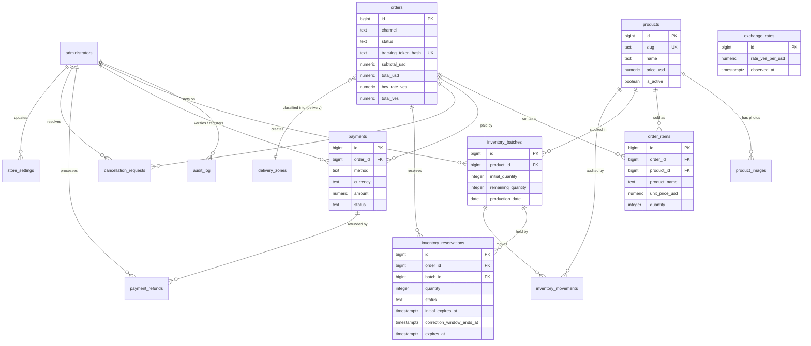

# DATABASE DESIGN

Proposed initial database architecture for Pastelería Online (Phase 1A design).

**Status:** M1 implemented in
`supabase/migrations/20261114023000_m1_catalog_and_admin_foundation.sql` —
the tables of §3–§5 and §10.2 plus the SPEC-confirmed seeds — validated by
applying the file to a local PostgreSQL cluster with a Supabase stub (roles,
`auth`, `storage`) and running behavioral RLS tests. **Not applied to any
remote Supabase project; no project exists yet (TASKS B1).** Sections 6–11
(inventory, orders, payments, …) remain design only. Every table below is a
proposal derived from
[`SPEC.md`](../SPEC.md); where the spec leaves a rule undefined, this document
records an open question instead of inventing an answer.

Companion document: [`SECURITY_DESIGN.md`](./SECURITY_DESIGN.md) (roles, RLS
policies, storage access). Decisions and rationale: [`DECISIONS.md`](./DECISIONS.md).

---

## 1. Conventions

Derived from the Supabase/Postgres best-practice guidelines applied throughout:

| Aspect | Convention |
| --- | --- |
| Schema | `public` (exposed via PostgREST). Helper functions live in `private` (not exposed). |
| Identifiers | Lowercase `snake_case`, plural table names (`orders`, `payments`). |
| Primary keys | `bigint generated always as identity` (`uuid` only where the value references an auth user). |
| Timestamps | `timestamptz not null default now()` — every table has `created_at`; mutable tables also have `updated_at` (maintained by trigger). |
| Strings | `text` (no artificial length limits). |
| Money | `numeric` — never float. USD amounts `numeric(10,2)`; VES totals `numeric(14,2)`; exchange rate `numeric(12,4)`; generic payment amounts `numeric(14,2)`. |
| Quantities | `integer` (portions), always `> 0` unless explicitly signed. |
| Statuses / enums | `text` + `CHECK (col IN (...))` — easier to evolve than Postgres enum types. Values are English `snake_case`; the UI translates to Spanish (mapping in §7). |
| Booleans | `boolean not null default …` |
| Constraints | Named (`{table}_{column}_check`, `{table}_{column}_fkey`). |
| Indexes | Every foreign-key column is indexed. Named `{table}_{columns}_idx`. Partial indexes for hot filters (pending work queues). |
| Deleting | Catalog and financial history are never hard-deleted in normal flows: FKs use `restrict` on history tables, `cascade` from an order to its lines/payments. Products are deactivated (`is_active = false`), zones are deactivated, not deleted. |
| Extensions | `pgcrypto` (for `digest()` when hashing tracking tokens). |

Nothing here implements business behavior: values, seeds and state transitions
are proposals to be applied in a later migration phase.

## 2. ER diagram

(Attributes shown are a readable subset; full column lists follow per table.
`exchange_rates` intentionally has no relationship lines: orders copy their
financial snapshot inline instead of referencing rate rows — §10.1.)

## 3. Catalog

### 3.1 `products`

**Purpose:** sellable catalog entries. Starts with three cake-portion varieties
but is fully data-driven — adding a product is an INSERT, never a code change
(SPEC §3). `price_usd` is the authoritative price: it is read by the server at
order creation and never accepted from the client.

| Column | Type | Null | Notes |
| --- | --- | --- | --- |
| `id` | bigint identity | no | PK |
| `slug` | text | no | URL key for `/productos/[slug]`; generated server-side from the name |
| `name` | text | no | |
| `description` | text | no | SPEC §3 requires a description |
| `price_usd` | numeric(10,2) | no | `CHECK (price_usd >= 0)` |
| `is_active` | boolean | no | default `true`; storefront shows only active rows |
| `created_at` | timestamptz | no | SPEC §3 |
| `updated_at` | timestamptz | no | SPEC §3, trigger-maintained |

- **Constraints:** `products_slug_key` UNIQUE (`slug`).
- **Indexes:** `products_slug_idx` (unique, serves lookup by slug),
  `products_active_idx (id) WHERE is_active` (partial index for the storefront
  listing — small and always filtered by `is_active`).
- **Relationships:** referenced by `product_images` (cascade), `order_items`
  (restrict — price history must survive deactivation/removal),
  `inventory_batches` (restrict), `inventory_movements` via batch.
- **Not stored here:** available stock. It is *derived* from batches minus
  active reservations (§6) — a denormalized counter would create the classic
  drift problem without a benefit at this scale.

### 3.2 `product_images`

**Purpose:** photographs per product (SPEC §3), stored as objects in the
**public** `product-images` bucket; rows keep the path and display order.

| Column | Type | Null | Notes |
| --- | --- | --- | --- |
| `id` | bigint identity | no | PK |
| `product_id` | bigint | no | FK `products` on delete cascade |
| `storage_path` | text | no | object path inside the bucket |
| `position` | integer | no | `CHECK (position >= 0)`; `0` is the primary photo |
| `created_at` | timestamptz | no | |

- **Constraints:** `product_images_storage_path_key` UNIQUE (`storage_path`).
- **Indexes:** `product_images_product_id_idx` (FK index; also used by the RLS
  policy that joins to `products.is_active`).
- **Relationships:** many-to-one `products`.

## 4. Configuration

### 4.1 `store_settings`

**Purpose:** singleton row (SPEC §6 pickup address, §13 WhatsApp, §14 hours,
§5 payment instructions). Fields whose structure the spec has not defined yet
are `jsonb` placeholders — deliberately **not** shaped in advance.

| Column | Type | Null | Notes |
| --- | --- | --- | --- |
| `id` | smallint | no | PK with `CHECK (id = 1)` — singleton |
| `pickup_address` | text | yes | configured from the panel (SPEC §6) |
| `whatsapp_phone` | text | yes | displayed/shared for manual WhatsApp contact (SPEC §13) |
| `business_hours` | jsonb | yes | **shape defined in Phase 6** when schedules are implemented (SPEC §14) |
| `payment_instructions` | jsonb | yes | **shape defined in Phase 4** from real Pago Móvil data (SPEC §5, §19 pending) |
| `updated_at` | timestamptz | no | trigger-maintained |
| `updated_by` | uuid | yes | FK `administrators` (set null) |

- **Invariant:** this table contains only customer-facing configuration; no
  secrets (secrets live in environment variables).
- **Relationships:** many-to-one `administrators` (who last edited).

### 4.2 `delivery_zones`

**Purpose:** classification the customer picks at checkout and the fee the
server applies (SPEC §6). Fees and zone *existence* come straight from the
spec; the exact geographic boundaries remain a pending discovery item and are
held as descriptive text, not invented geometry.

| Column | Type | Null | Notes |
| --- | --- | --- | --- |
| `id` | bigint identity | no | PK |
| `name` | text | no | unique |
| `description` | text | yes | human-readable boundary hint; exact limits pending (SPEC §19) |
| `fee_usd` | numeric(10,2) | no | `CHECK (fee_usd >= 0)`; meaningful only when `requires_quote = false` |
| `requires_quote` | boolean | no | default `false`; `true` = manual quote (orders wait for the confirmed fee) |
| `is_active` | boolean | no | default `true` |
| `sort_order` | integer | no | default `0`; checkout display order |
| `created_at` / `updated_at` | timestamptz | no | |

- **Proposed seed rows (from SPEC §6, to be inserted by the migration):**
  1. *Zona norte de Barquisimeto* — `fee_usd = 0`, `requires_quote = false`
  2. *Resto de Barquisimeto* — `fee_usd = 5.00`, `requires_quote = false`
  3. *Fuera de Barquisimeto* — `fee_usd = 0` (unused placeholder), `requires_quote = true`
- **Indexes:** `delivery_zones_name_key` (unique);
  `delivery_zones_active_idx (sort_order, id) WHERE is_active`.
- **Relationships:** referenced by `orders.delivery_zone_id` (restrict —
  deactivate zones instead of deleting them).

## 5. Identity: administrators

### 5.1 `administrators`

**Purpose:** the **single source of truth for authorization**. Supabase Auth
holds credentials (`auth.users`); this table decides who is allowed to do
anything administrative. A user is an admin only if a row exists here with
`is_active = true`. `user_metadata` is never consulted (SPEC §16).

| Column | Type | Null | Notes |
| --- | --- | --- | --- |
| `id` | uuid | no | PK, FK `auth.users(id)` on delete cascade — the auth identity |
| `display_name` | text | no | shown in the panel and written into the audit log |
| `is_active` | boolean | no | default `true`; deactivation revokes access on the next query (policies read this table live) |
| `created_at` | timestamptz | no | |

- **Provisioning:** rows are inserted only with the service role (dashboard or
  migration seed) after the two accounts exist — clients have no INSERT policy
  (see `SECURITY_DESIGN.md` §4).
- **Roles:** SPEC §2 gives both administrators **identical permissions**, so
  there is deliberately **no role column** — inventing a permission hierarchy
  would exceed the spec. Adding a `role` column + extending the authorization
  helper is a compatible future migration if granular permissions are ever
  required.
- **Open question:** the two administrators' e-mail addresses are unknown
  (not covered by SPEC §19) and are required before the accounts can be
  provisioned — tracked in `TASKS.md` as a Phase 1 blocker.
- **Relationships:** referenced by audit, inventory, payment, refund and
  cancellation rows (who did what).

## 6. Inventory (continuous management)

Three tables model SPEC §8: physical stock (batches), what an order has taken
out but not yet paid for (reservations), and the immutable trail of every change
(movements).

### 6.1 `inventory_batches`

**Purpose:** physical lots of ready-made portions. FIFO allocation reads
batches oldest-first (`production_date`, then `id`).

| Column | Type | Null | Notes |
| --- | --- | --- | --- |
| `id` | bigint identity | no | PK |
| `product_id` | bigint | no | FK `products` on delete restrict |
| `initial_quantity` | integer | no | `CHECK (initial_quantity > 0)` — portions baked (SPEC §8) |
| `remaining_quantity` | integer | no | `CHECK (remaining_quantity >= 0 AND remaining_quantity <= initial_quantity)` |
| `production_date` | date | no | **administrative only — never selected by storefront queries** (SPEC §8) |
| `created_by` | uuid | no | FK `administrators` — responsible admin (SPEC §8) |
| `created_at` | timestamptz | no | |

- **Indexes:** `inventory_batches_product_fifo_idx (product_id, production_date, id)`
  (FIFO scan order and the batch-lookup join), partial
  `inventory_batches_available_idx (product_id, id) WHERE remaining_quantity > 0`.
- **Invariant:** `remaining_quantity` is maintained only by the allocation /
  entry / adjustment RPCs together with a matching `inventory_movements` row
  (movement `sum` per batch must equal `remaining_quantity`; enforced by the
  code path, optionally a constraint trigger later).

### 6.2 `inventory_reservations`

**Purpose:** an online order reserves its batches the moment it is created;
reserved units are invisible to other buyers until the reservation is consumed
(sale), released (authorized cancel), or expires. Deadlines are short and
customer-driven (SPEC §8 "Reservas"): the **initial reservation expires after
20 minutes** if no payment receipt is submitted, and a **rejected receipt
grants one additional 15-minute correction window**. The 24-hour figure
(SPEC §14) is the administrators' operational deadline for managing incoming
orders — **not** a reservation duration (DECISIONS #24).

| Column | Type | Null | Notes |
| --- | --- | --- | --- |
| `id` | bigint identity | no | PK |
| `order_id` | bigint | no | FK `orders` on delete cascade |
| `batch_id` | bigint | no | FK `inventory_batches` on delete restrict |
| `quantity` | integer | no | `CHECK (quantity > 0)` |
| `status` | text | no | default `active`; `CHECK (status IN ('active','consumed','released','expired'))` |
| `initial_expires_at` | timestamptz | no | `created_at + 20 min` (SPEC §8); immutable — records the **initial** deadline even after a correction window moves the operative one |
| `correction_window_ends_at` | timestamptz | yes | set **once**, when a receipt rejection opens the correction window: `rejected_at + 15 min` (SPEC §8); null if never granted — distinguishes the correction window from the initial expiry |
| `expires_at` | timestamptz | yes | current **operative** deadline (materialized for simple queries/indexes); `NULL` = **held**, i.e. no deadline is running (receipt awaiting verification, or reservation secured after approval). Invariant: `expires_at IS NULL OR expires_at = coalesce(correction_window_ends_at, initial_expires_at)`. Written only by server-side reservation/payment RPCs — never by a client |
| `created_at` | timestamptz | no | |
| `closed_at` | timestamptz | yes | when consumed/released/expired |

- **Availability rule:** `available(batch) = remaining_quantity − Σ(quantity of
  active reservations where (expires_at IS NULL OR expires_at > now()))`.
  A held reservation (`expires_at IS NULL`) always counts; a lapsed one never
  does.
- **Effect of expiry on inventory (lazy):** once `expires_at` passes, the
  reservation stops counting toward availability **immediately** — its units
  become buyable again with no background job; a `release_expired_reservations()`
  cleanup invoked opportunistically by server code flips the row to
  `status = 'expired'` and sets `closed_at`. Expiry never touches
  `remaining_quantity` — physical stock changes only through a matching
  `inventory_movements` row.
- **A rejection never releases inventory:** a rejected receipt only moves the
  reservation from *held* to *running* with the 15-minute window
  (`expires_at = correction_window_ends_at`). Release happens solely on an
  authorized cancellation; consumption on completion; expiry when the deadline
  lapses (SPEC §8).
- **The correction window is bounded:** it is granted at most **once** per
  reservation — a second rejection re-uses the recorded
  `correction_window_ends_at` and never extends it, so repeated
  rejection/resubmission cannot create unlimited extensions (policy confirmed
  as OQ-14 before Phase 4).
- **Hold semantics:** submitting a receipt sets `expires_at = NULL` while the
  administrator verifies (the customer has acted; the clock must not run during
  review). This interpretation follows from the confirmed rules (20 min for the
  customer, 24 h for the admin) and is flagged as OQ-15; the nullable column
  supports it without any schema change.

**Lifecycle and state consistency (event → reservation → payment → order):**

| Event | Reservation effect | Payment state | Order state |
| --- | --- | --- | --- |
| Online order created | FIFO batches allocated; `expires_at = created_at + 20 min` | — | `pending` |
| Receipt submitted | held: `expires_at = NULL` | `pending` → `in_review` | `pending` |
| Receipt **rejected** | window opens: `expires_at = correction_window_ends_at = rejected_at + 15 min` — **no inventory released** | `rejected` | stays `pending` (SPEC §10: order status independent of payment status) |
| Receipt resubmitted inside the window | held again (`expires_at = NULL`); window **not** re-armed | new/updated component `pending`/`in_review` | `pending` |
| Window lapses without a valid resubmission | lazily excluded from availability → cleanup sets `expired` | stays `rejected` | → `expired` |
| Receipt approved | held (`expires_at = NULL`) until completion | `approved` | `pending → confirmed` (normal flow) |
| Cancellation authorized (SPEC §11) | `released`; units available again immediately | untouched (refund recorded separately) | `canceled` |
| Order completed | `consumed` → `sale` movement | `approved` | `completed` |

The nullable `expires_at` also covers orders that never upload a receipt (cash
on delivery) or wait for a manual delivery quote — their hold/expiry timing is
an open question (OQ-13), not a schema change.

- **Indexes:** `inventory_reservations_order_id_idx`, partial
  `inventory_reservations_active_batch_idx (batch_id) WHERE status = 'active'`,
  partial `inventory_reservations_expiry_idx (expires_at) WHERE status = 'active'`
  (held rows have `expires_at IS NULL` and are never expiry candidates).

### 6.3 `inventory_movements`

**Purpose:** append-only history of every stock change (SPEC §8): entries,
sales, negative adjustments (damage, internal consumption, losses) and positive
corrections — each with date, product (via batch), quantity, reason and the
responsible admin.

| Column | Type | Null | Notes |
| --- | --- | --- | --- |
| `id` | bigint identity | no | PK |
| `batch_id` | bigint | no | FK `inventory_batches` on delete restrict |
| `type` | text | no | `CHECK (type IN ('entry','sale','adjustment'))` |
| `quantity` | integer | no | **signed**: positive = increase, negative = decrease; `CHECK (quantity <> 0)`; `CHECK (type <> 'entry' OR quantity > 0)` |
| `reason` | text | yes | `CHECK (type <> 'adjustment' OR reason IS NOT NULL)` — adjustments require a motive (SPEC §8) |
| `order_id` | bigint | yes | FK `orders` on delete set null — links sale movements to their order |
| `admin_id` | uuid | yes | FK `administrators` on delete set null — **null = system-initiated** (online sale/reservation consumption). See open question OQ-9 |
| `created_at` | timestamptz | no | |

- **Indexes:** `inventory_movements_batch_id_idx`, `inventory_movements_order_id_idx`,
  `inventory_movements_created_at_idx (created_at DESC)`.
- **Note:** `production_date` never appears in this table, and storefront
  queries never touch inventory tables directly (stock is served through a
  server-side function — see §11).

## 7. Checkout, orders and tracking

### 7.0 Shopping cart — decision: no table

There is **no `carts` table.** SPEC requires a guest checkout that recalculates
everything server-side; the cart is client state (stored in the browser) and is
submitted as `{product_id, quantity}[]`. The server ignores any price the
client sends, re-reads `products.price_usd`, checks availability and creates the
order atomically. A persisted guest cart would add an anonymous-writable table
(and its RLS surface) for a capability the spec never asks for; it can be added
later without affecting orders. (DECISIONS #15)

### 7.1 `orders`

**Purpose:** one row per order — both channels. Online orders carry guest data,
a tracking token and delivery/pickup; walk-in sales (`channel = 'pos'`, SPEC §9)
reuse the same table so payments, inventory movements and the audit trail have a
single spine instead of duplicated tables. (DECISIONS #16)

| Column | Type | Null | Notes |
| --- | --- | --- | --- |
| `id` | bigint identity | no | PK (internal identifier, SPEC §7) |
| `channel` | text | no | default `online`; `CHECK (channel IN ('online','pos'))` |
| `status` | text | no | default `pending`; `CHECK (status IN ('pending','confirmed','ready','completed','canceled','expired'))` — SPEC §10 order states |
| `tracking_token_hash` | text | yes | SHA-256 of the random token; UNIQUE. Plaintext exists only once, in the creation response (SPEC §7, §16) |
| `customer_name` | text | yes | guest snapshot (SPEC §7); required for `online` via CHECK |
| `customer_phone` | text | yes | WhatsApp number (SPEC §7); required for `online` |
| `fulfillment_type` | text | yes | `CHECK (fulfillment_type IN ('delivery','pickup'))`; required for `online`, null for `pos` |
| `delivery_zone_id` | bigint | yes | FK `delivery_zones` restrict; required when `delivery` |
| `address_line` | text | yes | free text — no geolocation (SPEC §6) |
| `address_references` | text | yes | location references (SPEC §7) |
| `additional_instructions` | text | yes | optional (SPEC §7) |
| `delivery_fee_usd` | numeric(10,2) | yes | snapshot of the applied fee; `CHECK >= 0`; null while a manual quote is pending (SPEC §6) or when pickup |
| `subtotal_usd` | numeric(10,2) | no | server-computed snapshot (SPEC §4) |
| `total_usd` | numeric(10,2) | no | server-computed snapshot (SPEC §4) |
| `bcv_rate_ves` | numeric(12,4) | yes | applied BCV rate snapshot (SPEC §4); `CHECK > 0` — see open question OQ-4 |
| `bcv_rate_at` | timestamptz | yes | timestamp of that rate (SPEC §4) |
| `total_ves` | numeric(14,2) | yes | `CHECK >= 0`; VES total calculated with the snapshot (SPEC §4) |
| `rounding_rule` | text | yes | **which** rule was applied (SPEC §4) — the rule itself is undefined, see OQ-5 |
| `created_at` / `updated_at` | timestamptz | no | |

**Row-level CHECKs (all same-row, no cross-table logic):**

- `orders_online_check`: `channel = 'online'` ⇒ `customer_name`,
  `customer_phone`, `fulfillment_type`, `tracking_token_hash` are all not null.
- `orders_pos_check`: `channel = 'pos'` ⇒ `fulfillment_type IS NULL`
  (a walk-in sale has no fulfillment step).
- `orders_pickup_check`: `fulfillment_type = 'pickup'` ⇒
  `delivery_zone_id IS NULL AND delivery_fee_usd IS NULL`.
- `orders_delivery_check`: `fulfillment_type = 'delivery'` ⇒
  `delivery_zone_id IS NOT NULL` (fee may stay null until a quote is confirmed).

**State machine (application-enforced):** DB constrains the *value domain*;
allowed transitions (`pending → confirmed → ready → completed`, cancel/expire
branches) live in the domain layer and are applied only by server code — the
client can never write this table (no anonymous access at all; admins go
through RLS-validated paths). SPEC §10 keeps order status independent of payment
status; there is no denormalized "paid" flag — payment coverage is derived (§11).

The `pending → expired` transition fires when the order's reservation deadline
lapses without a held or approved payment (§6.2); a receipt rejection alone
never expires or cancels an order. The 24-hour administrator deadline
(SPEC §14) is an **operational SLA** surfaced in the dashboard (age computed
from `created_at`) — it is deliberately not a column and not a reservation
duration; whether it has any automatic enforcement is OQ-16.

- **Indexes:** `orders_status_created_at_idx (status, created_at DESC)`
  (dashboard queues), partial `orders_pending_idx (created_at DESC) WHERE status = 'pending'`,
  `orders_customer_phone_idx (customer_phone)` (admin lookup from a WhatsApp
  conversation), `orders_delivery_zone_id_idx`, unique
  `orders_tracking_token_hash_key` (drives private tracking lookups),
  implicit `created_at DESC` index for the activity feed.

### 7.2 `order_items`

**Purpose:** what was ordered, with a full price/name snapshot so history never
changes when the catalog changes (SPEC §4 requires historical product prices).

| Column | Type | Null | Notes |
| --- | --- | --- | --- |
| `id` | bigint identity | no | PK |
| `order_id` | bigint | no | FK `orders` on delete cascade |
| `product_id` | bigint | no | FK `products` on delete restrict |
| `product_name` | text | no | snapshot |
| `unit_price_usd` | numeric(10,2) | no | snapshot written by the **server** from `products.price_usd`; `CHECK >= 0` |
| `quantity` | integer | no | `CHECK (quantity > 0)` |

- Line total is `unit_price_usd * quantity` (exact decimal math, computed in
  queries/application — no stored column to drift).
- **Indexes:** `order_items_order_id_idx`, `order_items_product_id_idx`.

## 8. Payments and verification

### 8.1 `payments`

**Purpose:** one row per payment **component** of an order (SPEC §5): Pago
Móvil, cash USD, and — in later phases — Binance methods; several rows may
belong to one order (combined payments), and each is verified individually. A
receipt is evidence, never automatic confirmation (SPEC §5); verification is an
explicit, admin-attributed state change.

| Column | Type | Null | Notes |
| --- | --- | --- | --- |
| `id` | bigint identity | no | PK |
| `order_id` | bigint | no | FK `orders` on delete cascade |
| `method` | text | no | `CHECK (method IN ('pago_movil','cash_usd','binance_pay','binance_transfer'))` — the four SPEC §5 methods; MVP UI only offers the first two (binance arrives later) |
| `currency` | text | no | `CHECK (currency IN ('USD','VES','USDT'))` (SPEC §5) |
| `amount` | numeric(14,2) | no | `CHECK (amount > 0)` |
| `reference` | text | yes | bank/transaction reference; `CHECK (method = 'cash_usd' OR reference IS NOT NULL)` (SPEC §5) |
| `receipt_path` | text | yes | object path in the **private** `payment-receipts` bucket; required for digital methods — server-enforced invariant (single-step upload+insert) |
| `amount_tendered_usd` | numeric(10,2) | yes | cash only: money offered, for change calculation (SPEC §5); `CHECK >= 0` |
| `status` | text | no | default `pending`; `CHECK (status IN ('pending','in_review','approved','rejected','refunded_partial','refunded_full'))` — SPEC §10 payment states |
| `registered_by` | uuid | yes | FK `administrators` — set when an admin records an external/walk-in payment (SPEC §9); null for guest checkout |
| `verified_by` | uuid | yes | FK `administrators` — who verified (SPEC §5) |
| `verified_at` | timestamptz | yes | |
| `idempotency_key` | text | yes | UNIQUE — client-generated per checkout attempt; kills duplicate submissions (SPEC §16) |
| `created_at` / `updated_at` | timestamptz | no | |

- **Indexes:** `payments_order_id_idx`, FK indexes for `registered_by` /
  `verified_by`, partial
  `payments_review_queue_idx (created_at DESC) WHERE status IN ('pending','in_review')`.
- **Derived, not stored:** "order fully paid" = Σ(approved amounts) covers the
  order total and no component is pending — computed by query/RPC (§11), never a
  column a client could influence.
- **Change (vuelto):** derived as `amount_tendered_usd − order.total_usd` at
  registration time — not stored (SPEC §5 asks only to *calculate* it).

### 8.2 `payment_refunds`

**Purpose:** SPEC §12 — refunds are recorded as **separate rows**; the original
payment is never edited beyond its lifecycle `status`.

| Column | Type | Null | Notes |
| --- | --- | --- | --- |
| `id` | bigint identity | no | PK |
| `payment_id` | bigint | no | FK `payments` on delete cascade |
| `amount` | numeric(14,2) | no | `CHECK (amount > 0)` |
| `currency` | text | no | `CHECK (currency IN ('USD','VES','USDT'))` — mirrors the original payment (server-enforced) |
| `method` | text | no | how the money was returned — **values undefined by SPEC §12**, see OQ-7 (no CHECK yet, on purpose) |
| `reason` | text | no | required (SPEC §12) |
| `admin_id` | uuid | no | FK `administrators` — responsible admin (SPEC §12) |
| `created_at` | timestamptz | no | |

- **Invariant (server-enforced):** Σ refunds per payment ≤ payment amount;
  crossing 100 % flips `payments.status` to `refunded_full`, otherwise
  `refunded_partial`.
- **Indexes:** `payment_refunds_payment_id_idx`, `payment_refunds_admin_id_idx`.

## 9. Cancellations

### 9.1 `cancellation_requests`

**Purpose:** SPEC §11 — customers request cancellation (from the tracking page
or WhatsApp, the latter entered by an admin); administrators decide. Creating a
request changes **nothing** about inventory or payments until an admin resolves
it, and resolution records who decided.

| Column | Type | Null | Notes |
| --- | --- | --- | --- |
| `id` | bigint identity | no | PK |
| `order_id` | bigint | no | FK `orders` on delete cascade |
| `status` | text | no | default `pending`; `CHECK (status IN ('pending','approved','rejected'))` |
| `source` | text | no | `CHECK (source IN ('tracking','whatsapp','admin'))` (SPEC §11) |
| `customer_reason` | text | yes | free text from the customer |
| `resolution_note` | text | yes | admin justification |
| `resolved_by` | uuid | yes | FK `administrators` |
| `resolved_at` | timestamptz | yes | |
| `created_at` | timestamptz | no | |

- **CHECKs:** `status = 'pending' ⇔ resolved_at IS NULL`, and
  `status <> 'pending' ⇒ resolved_by IS NOT NULL`.
- **Duplicate protection:** partial UNIQUE `cancellation_requests_order_pending_key`
  on `(order_id) WHERE status = 'pending'` — at most one open request per order
  (SPEC §16 duplication rules).
- **Resolution side effects** (release reservation, record refund) are executed
  by server code in the same transaction when the request is approved — never
  by the customer.
- **Indexes:** partial `cancellation_requests_pending_idx (created_at DESC) WHERE status = 'pending'`,
  `cancellation_requests_order_id_idx`, `cancellation_requests_resolved_by_idx`.

## 10. Exchange rates, audit

### 10.1 `exchange_rates`

**Purpose:** SPEC §4 — store every retrieved BCV rate historically and serve
the "last known rate" fallback with its age. The **query mechanism is a pending
discovery item** (SPEC §19); this design only defines where rates live.

| Column | Type | Null | Notes |
| --- | --- | --- | --- |
| `id` | bigint identity | no | PK |
| `rate_ves_per_usd` | numeric(12,4) | no | `CHECK (rate_ves_per_usd > 0)` |
| `observed_at` | timestamptz | no | timestamp reported by the source, UNIQUE |
| `source` | text | yes | where it came from — undefined until OQ-4/SPEC §19 resolves |
| `created_at` | timestamptz | no | when we stored it |

- **Indexes:** `exchange_rates_observed_at_key` (unique) serves both "rate at
  time X" and "latest rate" lookups.
- **Note:** orders store the applied rate **inline** (snapshot columns, §7.1)
  with **no FK** to this table — a historical order must keep its financial
  snapshot even if rate rows are ever edited or pruned.

### 10.2 `audit_log`

**Purpose:** SPEC §16 "auditoría de operaciones administrativas" — append-only
trail of important admin operations (product edits, inventory adjustments,
payment verifications, status changes, refunds, settings changes).

| Column | Type | Null | Notes |
| --- | --- | --- | --- |
| `id` | bigint identity | no | PK |
| `admin_id` | uuid | yes | FK `administrators` on delete set null; null = system/service-role action |
| `action` | text | no | naming convention `domain.verb` (`product.update`, `payment.verify`, `inventory.adjust`, `order.status_change`, `refund.create`, `settings.update`) |
| `entity_type` | text | no | e.g. `order`, `payment`, `product` |
| `entity_id` | text | no | text so any PK shape fits |
| `data` | jsonb | yes | context: `{"before": …, "after": …}` as applicable |
| `created_at` | timestamptz | no | |

- **Append-only:** RLS grants INSERT (as the acting admin) but no UPDATE or
  DELETE policy to any client role — see `SECURITY_DESIGN.md` §4.
- **Indexes:** `audit_log_created_at_idx (created_at DESC)`,
  `audit_log_entity_idx (entity_type, entity_id)`, `audit_log_admin_id_idx`.

## 11. Derived data, views and functions

No table duplicates another table's state. Everything derived is computed:

| Name | Kind | Audience | Purpose |
| --- | --- | --- | --- |
| `get_product_stock(p_product_id)` | function | service role (server-rendered storefront) | available / reserved / remaining aggregates — keeps `production_date` away from the public entirely (SPEC §8) |
| `create_online_order(...)` | function | service role only | validates products/zones, recomputes all totals from `products`, allocates FIFO batches, writes snapshots + reservations (`expires_at = created_at + 20 min`), returns `{order_id, tracking_token}` once (Phase 3) |
| `release_expired_reservations()` | function | service role only | lazy expiry cleanup: flips reservations past their operative deadline (20 min initial / 15 min correction window) to `expired` (Phase 3) |
| `consume_order_reservations(p_order_id)` | function | service role only | converts reservations into `sale` movements on completion (Phase 2/3) |
| `adjust_inventory(...)` | function | authenticated, internal `is_admin()` check | atomic entry/adjustment with movement row (Phase 2) |
| `get_order_for_tracking(p_token)` | function | service role only | hashes the token, looks up the order, returns a **PII-free projection** (status, items, totals, timestamps, cancellation state) — see SECURITY_DESIGN §6 |
| `request_order_cancellation(p_token, p_reason)` | function | service role only | inserts a `cancellation_requests` row without touching the order (Phase 3) |
| `order_payment_summary` | view (`security_invoker = true`) | authenticated admins (anon revoked) | per-order approved/pending/refunded totals for the dashboard |

**Realtime (Phase 6):** `orders`, `payments` and `cancellation_requests` will be
added to the `supabase_realtime` publication; Realtime respects the same RLS
policies, so administrators receive only what they may already read.

## 12. Status value mapping (SPEC Spanish → stored English)

| SPEC §10 | Stored value |
| --- | --- |
| Pedido: Pendiente de pago o verificación | `orders.status = 'pending'` |
| Pedido: Confirmado | `'confirmed'` |
| Pedido: Listo para retirar o entregar | `'ready'` |
| Pedido: Completado | `'completed'` |
| Pedido: Cancelado | `'canceled'` |
| Pedido: Expirado | `'expired'` |
| Pago: Pendiente | `payments.status = 'pending'` |
| Pago: En revisión | `'in_review'` |
| Pago: Aprobado | `'approved'` |
| Pago: Rechazado | `'rejected'` |
| Pago: Devuelto parcialmente | `'refunded_partial'` |
| Pago: Devuelto totalmente | `'refunded_full'` |

## 13. Extensibility: whole cakes made to order (not in the MVP)

The MVP models ready-made portions only (SPEC §8 — no production on demand).
Nothing blocks adding made-to-order whole cakes later:

- `products` gains (in a future migration) an availability-mode marker
  (e.g. `made_to_order` + lead time); existing rows are untouched.
- The allocation function branches on that flag: made-to-order products skip
  FIFO batch allocation; portion products keep the current path.
- `order_items` already snapshots name/price, so a new product kind needs no
  structural change; `inventory_batches`/`movements` remain the record for
  anything physically produced.
- New payment methods (Binance) only widen the `method` CHECK; new
  administrators are new `administrators` rows; more products are data.

## 14. Open questions (genuine gaps — not invented here)

| ID | Question | Blocks |
| --- | --- | --- |
| OQ-1 | The two administrators' e-mail addresses (not in SPEC §19) | Provisioning auth accounts + `administrators` seed |
| OQ-2 | Final catalog: names, descriptions, prices, photos (SPEC §19) | Product seed data, slugs |
| OQ-3 | Exact geographic limits of the "north zone" (SPEC §19) | `delivery_zones.description` content + customer classification UX (table itself is not blocked) |
| OQ-4 | How the BCV rate is queried/stored, and whether **USD-only orders** also snapshot the rate (SPEC §4, §19) | `exchange_rates` write path; nullability of `bcv_rate_*`/`total_ves` |
| OQ-5 | The actual rounding rule to record in `rounding_rule` (SPEC §4 requires the snapshot, never defines the rule) | Phase 4 totals calculation |
| OQ-6 | Shape of Pago Móvil receiver data (SPEC §19) | `store_settings.payment_instructions` structure (Phase 4) |
| OQ-7 | Allowed refund methods (SPEC §12 requires the field, not the value list) | `payment_refunds.method` CHECK (Phase 5) |
| OQ-8 | Shape of attention/preparation schedules (SPEC §14) | `store_settings.business_hours` structure (Phase 6) |
| OQ-9 | SPEC §8 says every movement keeps an "administrator", but automated online-sale movements have no acting admin — proposed: `admin_id` nullable with null = system | Confirm before Phase 2 migration |
| OQ-10 | Should the storefront display per-product stock (SPEC §3 lists "inventario disponible" ambiguously)? | Whether `get_product_stock` output is shown publicly (design supports it either way) |
| OQ-11 | Are walk-in (POS) sales recorded without customer identity? Proposed: yes — all customer columns nullable for `channel = 'pos'` | Phase 5 |
| OQ-12 | May a guest re-view their own uploaded receipt from the tracking page? Proposed: yes, via a short-lived signed URL issued by server code after token validation (no storage-policy change) | Phase 4 tracking/payment UI |
| OQ-13 | Does the 20-minute initial reservation clock apply to orders that never upload a receipt (cash on delivery) or that wait for a manual delivery quote (SPEC §6/§8)? Proposed: the clock tracks *customer obligations* — it holds while waiting on the admin/quote and runs only when the customer owes a receipt | Phase 3 checkout reservation logic (schema already supports it via nullable `expires_at`) |
| OQ-14 | Repeat rejection policy: confirm the proposal that the 15-minute correction window is granted **once** per reservation and later rejections never extend it (bounded, no unlimited extensions). Alternative (needs explicit approval): each rejection re-arms 15 minutes | Phase 4 receipt-rejection RPC behavior |
| OQ-15 | Confirm the hold rule: a submitted receipt awaiting verification suspends the reservation deadline (`expires_at = NULL`) until an administrator acts — required for the 15-minute window to be meaningful when verification is slow | Phase 3/4 reservation RPCs (behavior only; no schema change) |
| OQ-16 | Enforcement of the 24-hour administrator deadline (SPEC §14): dashboard warning only (proposed), or automatic order expiry? | Phase 6 dashboard/notifications |

